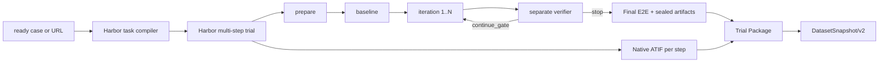

# Harbor-native architecture

Harbor 0.25.0 是唯一 task/trial harness。Restore 只保留合同、取证、比较、评分、报告和归档审计等领域工具，不再拥有完整 loop、checkpoint、Job 或 trajectory transport。



## Ownership

| Owner | Owns | Does not own |
| --- | --- | --- |
| Harbor | task、trial、multi-step、Agent session、early stop、separate verifier、artifacts、ATIF、regrade | Restore 评分含义、case 生命周期 |
| Restore domain tools | 合同/fixture 校验、capture、snapshot/hash/diff、assessment、pairwise verify、Final E2E、report、archive/scratch audit | task/trial 生命周期、自动续跑、轨迹传输 |
| Case Manager | `draft → ready → retired` 和 `cases.yaml` | 自动把 URL 写成正式 case |
| Data Factory | Harbor trial → Trial Package → Snapshot，资格/隔离/去重/分组切分 | 训练执行、模型注册、部署 |

## Task contract

- `task.toml` schema 1.4。
- `ordinary/refined/complex` 分别声明 3/6/9 个 iteration step。
- verifier 使用 `environment_mode = "separate"` 且无网络。
- Agent 与环境使用固定 digest 镜像；网络只允许目标 host 与 fixture manifest 声明的 host。
- `/workspace/restore-run` 声明为 artifact，并按原路径提供给独立 verifier。
- `min_reward = { continue_gate = 1 }` 只控制是否执行下一 step。
- `multi_step_reward_strategy = "final"` 只采用最后实际执行 step 的正式质量评分。
- Skill 通过 Harbor `--skill .` 注入；job lock 记录 Skill digest 和 Git commit，不复制到 task。
- 启动前对所选 Agent 做 capability preflight；本项目要求 `atif=true`、`resume=true`、`skills=true`，否则失败关闭。

最终质量字段只有 `restore_layout`、`restore_style`、`restore_content`、`restore_interaction`、`restore_robustness`、`restore_total`、`restore_redline_pass`。缺证据时 trial/包保持 incomplete，不补零。

## Input routes

```text
ready case → 验证 status/fixture/evidence/image digest → 编译正式 task
URL        → 创建 exploratory task → prepare 冻结合同 → 不写 cases.yaml
no URL     → 停止并要求 URL
```

正式 case 还必须有 `evals/fixtures/<case-id>/manifest.json`、冻结证据、视口/状态、资源 SHA-256 和固定镜像 digest。当前所有 case 仍是 draft。

## Runtime boundary

POLA 直接 URL 已实跑验证执行与数据链路，独立视觉质量仍 incomplete。真实验收范围、ATIF 版本与剩余限制统一见 [自动入口](../references/harbor/automation.md)。正式 ready-case 和提前停止仍未实跑。
