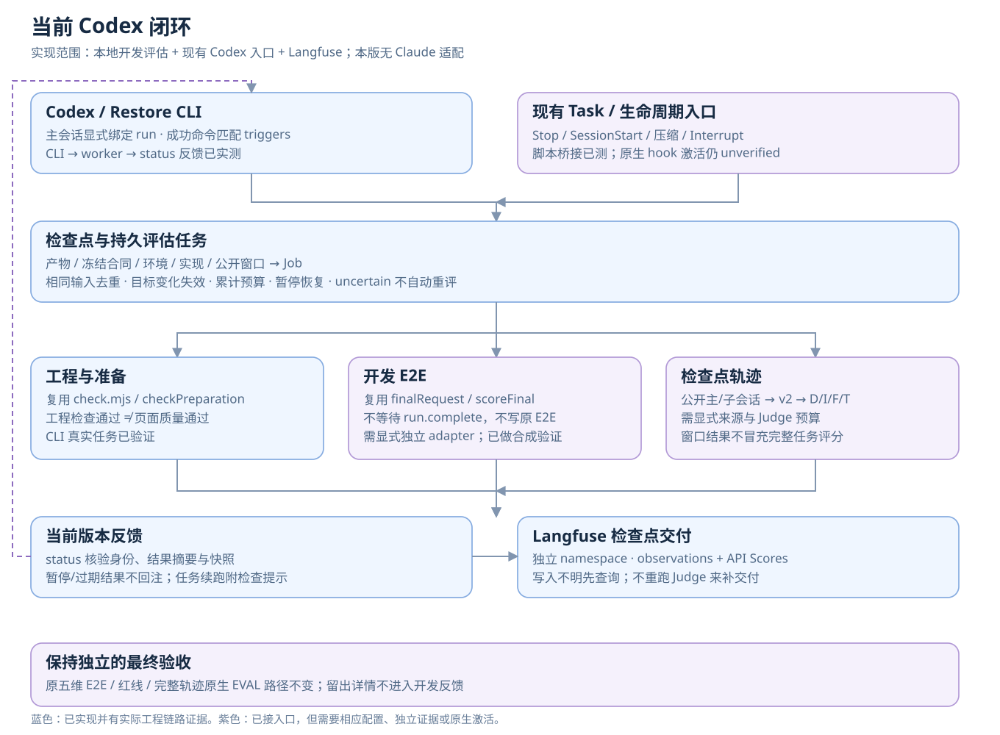
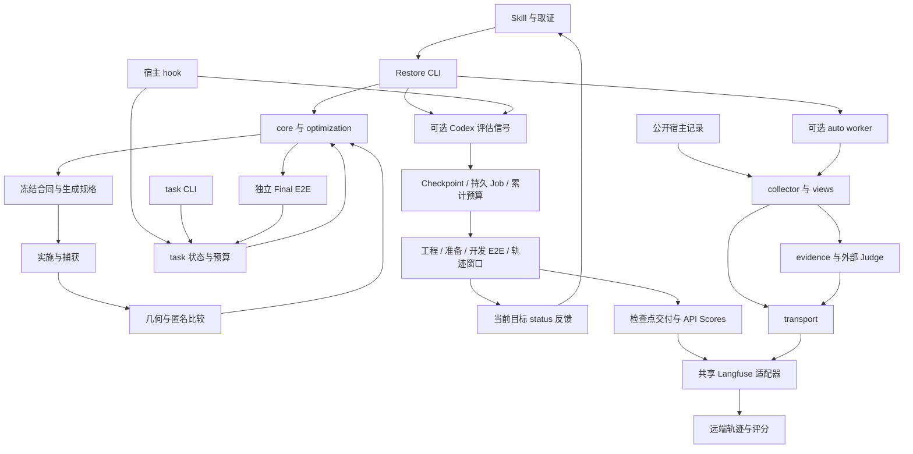

# Restore vNext 模块与架构

[文档索引与版本约定](README.md) · [当前评测方案](evaluation-plan.md)。本页描述当前架构；验证状态为 evidence_as_of 的快照，不表示文档更新时重新执行验收。

本项目仍是个人维护的离线 Skill：冻结文件提供数据契约，本地 ESM 模块提供可复用函数，CLI 负责显式编排。四个优化项均有实现入口，但自动化激活、工程正确性和网站质量分别验收。架构不依赖本机 Firewood 路径、常驻服务或新 SDK 包。

## 四个优化项的接入位置

| 优化项 | 实现与主流程接入 | 数据契约 / 唯一控制文档 | 当前边界 |
| --- | --- | --- | --- |
| 还原准备与资产规范 | [optimization.mjs](../scripts/restore/optimization.mjs) 提供校验/投影/资源继承；[core.mjs](../scripts/restore/core.mjs) 在冻结、生成和继承中调用；[CLI](../scripts/restore/cli.mjs) 提供 init-vnext、prepare-check、brief | [Restore 接口](../references/restore/interfaces.md)、[optimization Schema](../references/restore/optimization.schema.json)、[generation v2](../references/restore/generation-input-v2.schema.json)、[资产布局](../references/restore/asset-layout.md) | 可选扩展；没有自动全站穷举器或自动设计 DNA 提取服务 |
| 视觉交互与音频还原 | [geometry.mjs](../scripts/restore/geometry.mjs) 生成静态诊断；[pairwise.mjs](../scripts/restore/pairwise.mjs) 调用 [blind.mjs](../scripts/restore/blind.mjs)；core 归档音频、[report.mjs](../scripts/restore/report.mjs) 播放证据；[reverse-motion-skill](../reverse-motion-skill/SKILL.md) 提供人工/Agent 取证方法 | [Loop Criteria](../references/restore/criteria.md)、[Restore 接口](../references/restore/interfaces.md)、[动效规格](../reverse-motion-skill/references/spec.md) | 几何与匿名偏好不是最终质量；动效/声音规格不是运行引擎或已安装生成工具 |
| 持久迭代闭环 | [task.mjs](../scripts/restore/task.mjs) 拥有任务状态/预算/交接；[hooks.mjs](../scripts/restore/hooks.mjs) 是宿主适配器；CLI 的 task-* 为显式入口；项目 [hooks 配置](../.codex/hooks.json) 连接宿主事件 | [task Schema](../references/restore/task.schema.json)、[任务接口](../references/restore/interfaces.md#任务连续性)、[激活验收](../evals/vnext-acceptance.md#continuity-activation) | 原 run.complete 语义不变；宿主激活仍 unverified；Skill 只输出提案 |
| 轨迹可观测与过程评估 | CLI 在 run 命令后调用 [auto.mjs](../scripts/trajectory/auto.mjs)；collector → views → evidence → judge → transport；[langfuse.mjs](../scripts/trajectory/langfuse.mjs) 提供共享协议适配器 | [轨迹接口](../references/trajectory/interfaces.md)、[过程评测](../evals/trajectory/README.md)、[rubric v2 增量](../evals/trajectory/rubrics-v2.json) | 需显式授权/配置/会话绑定；隐藏内容不可恢复；语义校准仍 unmeasured |

2026-11-03 当前实施收敛为 [Codex 开发评估闭环](../references/evaluation/interfaces.md)：`scripts/evaluation/` 提供 coordinator/checkpoint/jobs、四种既有 runner 适配、Codex CLI/生命周期桥接和 Langfuse 检查点交付。开发 E2E 与有界轨迹窗口不再必须等 run.complete；完整任务后评估仍沿用原 worker。CLI 信号→后台任务→status 反馈已实测；原生 hook 激活仍 unverified。没有 Claude 适配或独立 SDK 包。



## 依赖与数据流



数据流不等于全部同步调用：网站控制器、宿主 hook 和限时观测 worker 是三个入口；task-* 不会自动触发轨迹 worker。直接调用 core/task 模块也不会执行 CLI 的 afterRestoreCommand。脚本集成者必须显式选择相应入口，不能把 import 成功当成自动上报已启用。

## 状态与依赖所有权

| 所有者 | 拥有的数据 / 责任 | 不承担的职责 |
| --- | --- | --- |
| core / optimization | run、冻结合同、候选、账本、资源完整性与生成白名单 | 不拥有模型隐藏上下文，不自动配置遥测 |
| task / hooks | task、session binding、累计预算、恢复决策与 Skill 提案 | 不改变 Final E2E 规则，不自动安装或信任宿主 hook |
| evaluation / codex / runners / delivery | 检查点与 Job、主会话/run 绑定、评估层额度、现有 runner 编排、当前目标反馈、独立检查点交付 | 不拥有网站验收状态，不复制 rubric，不唤醒停止应用，不把检查点分当完整过程分 |
| collector / views / delegation | 规范化公开事件、有来源的逻辑视图、事前公开委派规格 | 不解密，不证明收到的完整模型上下文 |
| evidence / judge | 按维输入、预算/缺口、外部判断与结构/时间校验 | 不用规则匹配代替语义评分，不宣告自身已校准 |
| transport / auto | 不可变交付、查询恢复、worker 锁与持久状态 | 不重生成网站，不把 worker 启动或 HTTP 成功当成验收 |
| langfuse | 配置解析、HTTP、分页、OTLP 封装、字段回读比较 | 不持有案例状态、重试策略或 Judge 调度 |
| langfuse-pilot | Firewood 历史账本与来源审计适配器；兼容重导出共享函数 | 不作为通用流程的依赖，不冒充宿主轨迹 |

共享传输已从 Firewood 试点抽出；auto/transport 直接依赖 langfuse，旧试点 import 路径通过重导出保持兼容。资产与页面工程文件、原始运行数据和远端评分仍按各自契约保存，不搬入 SDK 源目录。

## 本地复用接口与依赖

本仓库没有发布独立 npm/Python SDK，也不新增包管理清单。维护者可以直接导入现有 `.mjs` 函数；这是仓库内接口，Schema 的版本兼容不代表每个 JavaScript 函数都具备公开 SDK 的稳定承诺。

```javascript
// 从项目根目录的示例 .mjs 调用；所有副作用由调用者显式发起。
import { checkPreparation } from './scripts/restore/optimization.mjs';
import { createViews } from './scripts/trajectory/views.mjs';
import { buildEvidencePayload } from './scripts/trajectory/evidence.mjs';
import { configFrom } from './scripts/trajectory/langfuse.mjs';
import { sendTraces } from './scripts/trajectory/transport.mjs';
```

- 准备/几何/状态：使用 optimization、geometry、task 的导出函数。写 run 时使用控制器的锁与接口，避免自行替换账本。
- 离线轨迹：normalizeSession / collectSessions → createViews → buildEvidencePayload；配置与作用域参数见[轨迹接口](../references/trajectory/interfaces.md)。这些步骤不会自动上传或执行 Judge。
- 自动观测：以 Restore CLI 或 armAutomatic / runWorker 为入口；start:false 只阻止启动进程，仍会写绑定文件。
- 网络交付：以 sendTraces 为持久化入口；直接 request/postJSON 是低层 HTTP 调用，不提供交付回执或重启幂等保障。
- 上述库模块 import 无自动上传/模型调用；CLI 文件是可执行入口，不应当作库 import。

运行端沿用 Node 内置模块与现有环境。统一检查器使用 Node 24+；Schema 检查复用已有 Python + jsonschema 环境；Case Manager 使用自己的 package-lock 与本地依赖。浏览器集成需要已安装、版本匹配的 Node/Python Playwright。真实上报需 Langfuse 项目配置；外部 Judge 另需 Codex CLI 与既有登录。没有安装的生成工具保留为路由指南。

## 变更与验收入口

统一工程检查见 [evals/README](../evals/README.md#统一工程检查)。修改模块时沿其依赖更新调用方、唯一契约和相应回归；真实上报、宿主激活、页面质量、效率与 Judge 校准各有独立验收，不能由统一检查器代替。未来只有出现多项目复用与稳定版本需求时，再决定是否提取可发布 SDK。

[原套件设计](evaluation-suite-design.md)保留完整目标与历史对照；当前实现与范围以 [Codex 闭环接口](../references/evaluation/interfaces.md)为准，跨宿主部分不进入本版。

## 当前取舍与后续验证

| 取舍 | 原因 | 重新审议条件 |
| --- | --- | --- |
| 当前只接 Codex、本地文件/ESM 与限时 worker | 适配既有 Skill，复用成熟评分/传输，降低改造成本 | 先证明当前闭环与收益，再依据实际复用需求扩展 |
| Task、评估 Job、完整过程评分分别拥有状态 | 网站完成、评估执行结束与质量通过不同 | 不因方便显示而合并状态/评分 |
| 开发反馈与独立最终验收分离 | 防止开发样例、已见结果冒充留出效果 | 具体实验按既有验收协议审阅 |

原生 hook、真实新增开发 E2E、Judge 校准及项目级提效仍需对应验收，顺序与资源见[当前评测方案](evaluation-plan.md#后续迭代与验收顺序)。设计视角沿用[历史提案中的端口/适配器与持续反馈取舍](evaluation-suite-design.md#1-结论与设计视角)，不因此扩展本版宿主边界。

## 文档迭代记录

| 时间 | 文档版本 | 迭代项 | 变化 |
| --- | --- | --- | --- |
| 2026-11-03 | 1.0.0 | IT-01～IT-06 | 首次引入文档版本；补齐 Codex 调度/反馈/交付数据流、状态所有权和待验收边界 |
