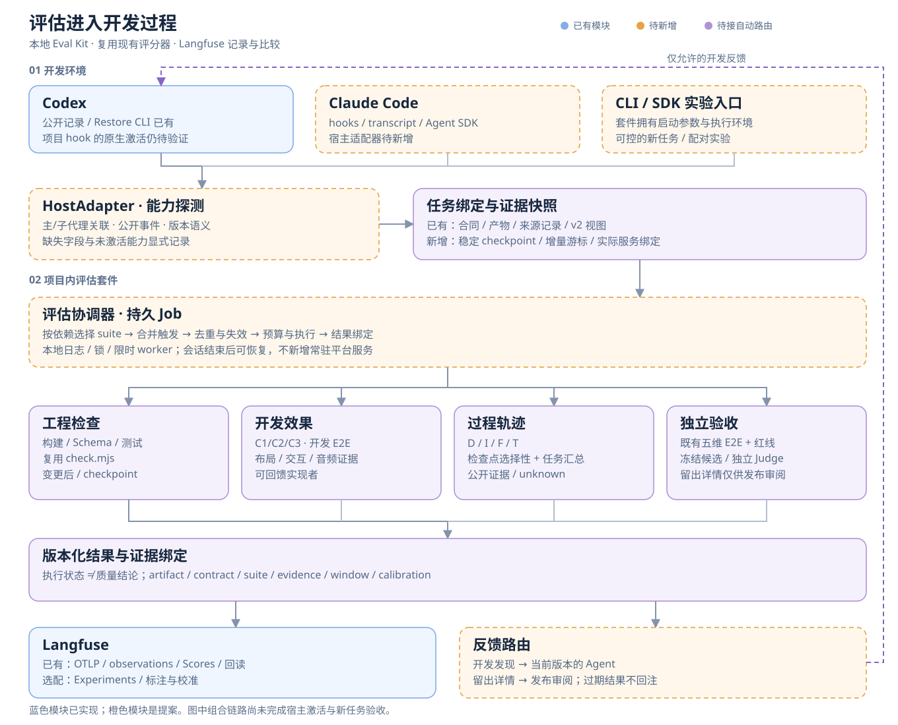
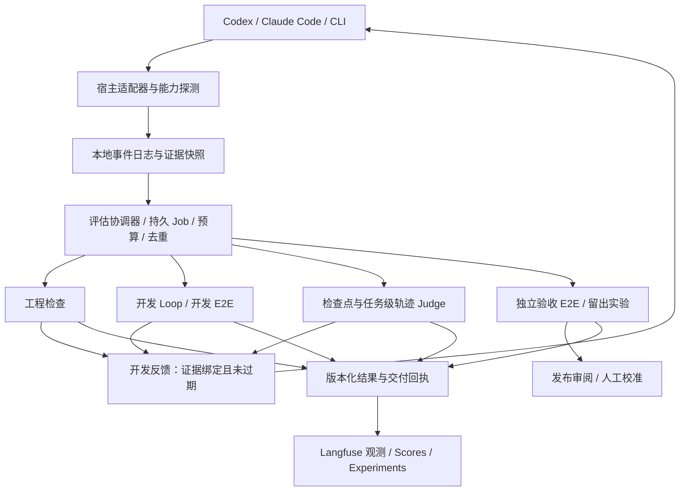

# 嵌入开发环境的评估套件：历史系统设计提案

**阅读边界：下文保留 2026-11-02 的设计背景；其中“当前”“未实现”“拟新增”均指原提案时点。最新能力以[当前架构](architecture.md)、[当前评测方案](evaluation-plan.md)及[Codex 接口](../references/evaluation/interfaces.md)为准。本文不是当前功能清单。**

日期：2026-11-02。状态：设计提案，未实现新的协调器、宿主适配器、SDK 或 hook 配置。沿用现有五维 E2E、六类红线、C1/C2/C3 和 D/I/F/T；不增加混合总分。当前实现见[模块架构](architecture.md)，评分定义仍由[最终 E2E](../evals/restore.md)、[Loop Criteria](../references/restore/criteria.md)和[轨迹评测](../evals/trajectory/README.md)分别控制。

**2026-11-03 范围更新：** 用户将本版收敛为当前 Codex 闭环。协调器、检查点/Job、现有评估器适配、CLI/生命周期桥接与检查点 Langfuse 交付已按[当前接口](../references/evaluation/interfaces.md)落地；下文 Claude/跨宿主 SDK 仍仅是历史提案，不属于当前工作范围。原生 hook 激活、真实站点的新增开发 E2E、窗口 Judge 语义校准分别保留实际证据边界。

## 1. 结论与设计视角

推荐“项目内的本地评估套件 + 宿主适配器 + 既有 Langfuse”。把评估嵌入需求确认、代码变更、可运行候选、任务检查点和 PR 验收。E2E 需要可运行候选与受控浏览器，不需要网站公开部署；发布后的真实流量监测可继续复用同一套结果模型。

反驳：开发中持续反馈不能替代独立验收。反复查看并优化的样例归入开发集；留出集的详细发现不返回本轮实现者。独立评审上下文与留出数据是两种不同隔离：独立 Judge 可以评开发集并返回反馈，这不使开发集成为留出集。

本设计采用两个框架：

- Alistair Cockburn 的[端口与适配器](https://alistair.cockburn.us/hexagonal-architecture)：评估核心不依赖某一宿主、界面或远端数据库。Codex、Claude、命令行、Langfuse 都通过适配器连接；断网时仍能保存和执行本地任务。
- Martin Fowler 的[持续集成](https://martinfowler.com/articles/continuousIntegration.html)：把可重复检查放进开发节奏，尽早获得反馈。这里借用自动验证与快速反馈，不声称当前 worktree 分支流程已符合其全部 CI 实践。

当前差距的判断置信度高，依据是代码入口与契约；新套件能提高多少质量或效率的置信度未知，必须实验测量。

## 2. 当前基础与缺口

| 部分 | 当前可复用 | 待补齐 |
| --- | --- | --- |
| 网站评估 | [core](../scripts/restore/core.mjs)、[capture](../scripts/restore/capture.mjs)、[pairwise](../scripts/restore/pairwise.mjs)、[grader](../evals/pipeline/grader.mjs)、报告与冻结绑定 | 检查点自动选择 suite，启动可复现候选并绑定实际服务到产物字节；开发 E2E 的预算与结果路由 |
| 轨迹评估 | collector/views/evidence/judge/transport、逐声明与逐约束检查、版本化回执 | 增量游标、跨宿主语义适配、检查点窗口、稳定事件幂等、选择性重评 |
| 自动入口 | Restore CLI 的 afterRestoreCommand；task/hooks 的显式会话绑定 | 当前 auto 在 phase=complete 后才运行完整 Judge；task hooks 不是统一评估调度器，直接库调用也不会自动触发它 |
| 工程检查 | [check.mjs](../scripts/check.mjs) 的 local/full 及日志、[Schema 检查](../scripts/validate-schemas.py) | 纳入 suite 描述与统一 Job 生命周期，保留原命令兼容 |
| 平台 | Langfuse OTLP、字段回读、Code evaluator 和原生评分 | 项目能力检查、选配实验映射、反馈路由；当前没有 Claude Code 采集器或通用 SDK |

Firewood 的既有历史补采用于兼容与恢复验证，不作为新套件的提效实验。不能从当前 Langfuse 轨迹完整度推断未来宿主适配器的覆盖率。

## 3. 总体架构



图中蓝色为已有可复用能力，橙色为待新增模块，紫色为已有实现但新的自动路由待接入。它是目标组合，不表示端到端自动化已完成。



协调器是本地函数与限时进程，不新增平台服务器、消息中间件或数据库。初版文件与锁即可；出现已测量的并发/查询瓶颈后再考虑 SQLite。暂停、中断、预算耗尽和远端失败均保存状态。

## 4. 宿主接入：同一内核，两种运行方式

| 模式 | Codex | Claude Code | 适用范围 |
| --- | --- | --- | --- |
| 被动接入现有开发会话 | 项目 hooks + 有来源的公开 transcript；当前 Codex JSONL 适配器复用，增加版本和事件能力检查 | 新增 hooks/transcript 适配器；关联主/子会话及公开用户、工具、结果 | 保留用户当前交互式开发方式，先以 shadow 模式验收 |
| 套件控制的重复实验 | 官方 Codex SDK / exec；需要自建完整客户端时才选 App Server | Claude Agent SDK / 非交互 CLI | 套件拥有启动参数、环境与事件流，适合新任务配对实验 |

[官方 OpenAI 文档](https://learn.chatgpt.com/docs/app-server)把 App Server 定位于自建深度客户端，将脚本/CI 引向 SDK。SDK/自建 App Server 可以观察自身管理的执行；不能据此假设可监听任意已打开的 Desktop 会话。[Codex hooks](https://learn.chatgpt.com/docs/hooks)提供生命周期/工具事件，但本机支持与信任仍须验证。

[Claude Code hooks](https://code.claude.com/docs/en/hooks)提供主会话 transcript 及子代理事件；SubagentStop 的 agent_transcript_path 可关联子会话，但 last_assistant_message 不一定是实际交接报告，适配器须兼容相应工具与版本。[Agent SDK](https://code.claude.com/docs/en/agent-sdk/overview)适合由套件管理的新执行，不能将它与现有交互会话直接画等号。

能力探测返回 host/version、可用事件、公开轨迹字段、subagent 关联、可信 hook 是否实际回调、反馈是否交付及采集缺口。缺少某种事件时降级到公开 transcript 或显式 CLI；没有实际回调证据时标 unsupported/unverified，不伪装自动接入完成。

MCP 可作为 Agent 显式请求 evaluate/status/inspect 的补充入口；它不能观测所有未经过自身的工具调用，因此不能单独承担完整采集与强制触发。

## 5. 四条评估通道

| 通道 | 触发 | 复用评估器 | 返回对象与权限 |
| --- | --- | --- | --- |
| 工程检查 | 相关文件变更后合并触发；显式 checkpoint；PR | check.mjs、Schema、启动/资源/程序检查 | 退出状态、失败检查、准确版本与缺口；可返回实现者。代码检查不替代语义 Judge |
| 开发效果 | 新的稳定候选、section 完成、核心路径变更 | C1/C2/C3、匿名比较、同语义交互/音频证据；需要时复用最终 grader 执行 development_e2e | 可操作的差异和反例；归入开发数据，允许修复，不宣称独立留出结果 |
| 过程轨迹 | 子任务交接、阶段 checkpoint、过程停止点 | D/I/F/T；开发中按改变的断言/约束选择性评估，任务关闭执行有界汇总 | 已知证据、unknown 与覆盖；逐事件采集不等于逐事件调用 LLM。窗口指标不能冒充完整任务评分 |
| 独立验收 | 冻结候选、显式任务验收、PR/版本门禁 | 既有五维 E2E/六红线；独立 Judge；受保护的留出实验 | 审阅/发布者接收结果。开发验收可回馈，但样本随即归开发；保留的留出详情不回送本轮实现者 |

沿用已授权的外部 Codex 语义 Judge。结构、哈希、时间与交付检查仍由代码完成；它们不替代模型判断。四条通道分别呈现结果、覆盖和成本，不合成一个“总 reward”。留出结果不得触发 producer 的自动下一轮；正式验收必须选择已冻结且完整覆盖的候选。

## 6. 触发、反馈与恢复

1. SessionStart 建立项目/任务/run/session 绑定，读取授权配置与已有游标；不凭最新 transcript 猜归属。
2. 用户消息、工具结果、Skill 读取和子代理交接先写公开事件及来源索引；对宿主可见用户消息与导出策略分别处理，不解密或补造隐藏内容。
3. hook 只持久化事件/检查点并唤起限时 worker，尽快返回。文件变更触发按声明依赖合并；稳定候选需要 snapshot/哈希/实际服务/环境绑定，而不是只看 git commit。
4. 协调器按 suite 依赖和数据变化生成 Job。Job ID/cache key 覆盖 suite 与 evaluator 版本、合同、产物/工作树、证据、轨迹游标、策略与环境；模型/提示配置影响的判断也必须失效。已运行的旧任务结果仍保留，标 stale，不覆盖旧结果。
5. worker 先做证据就绪检查，再执行业务评估。缺数据返回 unknown/blocked 与补证目标；网络中断保存本地结果和待核对回执。未确认写入先查询，外部 Judge 已开始但无结论时不自动重花预算。
6. FeedbackAdapter 仅发送当前版本、权限允许的简短 findings 与证据链接；完整数据留本地报告/Langfuse。反馈等待安全点，不能保证后台完成即自动开启下一轮。
7. Stop 只检查必要开发任务的状态，按预算与宿主协议决定是否允许有界续跑；不在 Stop 中同步等待长时 Judge，不把远端可用性当成源码修改的常驻依赖。中断优先，待办保留。
8. 下一次 SessionStart 或显式 drain 恢复未完成任务。Codex 官方文档说明后台 hook 不会自行开始新一轮，且结束会话时会取消未完成 hook；Claude 非交互会话也有后台任务退出边界。持久文件不是唤醒服务，真实行为必须按版本实测。

### 执行状态与评估结论分开

Job：queued → claimed → running → completed / failed / cancelled / unavailable；崩溃或远端回执不明为 uncertain，先核对再恢复。stale 是目标已变更的标记；completed 只代表执行结束。

Assessment：复用原结果的 scored / unknown / not_applicable、红线和 pass/fail/incomplete 等契约。不能把 execution=completed 映射成 quality=pass；旧成功也不能给新产物背书。

## 7. 最小数据契约（均为拟新增，不替换原 Schema）

| 记录 | 核心字段 | 来源与缺失处理 |
| --- | --- | --- |
| HostCapability | host/version、events、public_fields、subagent_link、trust_observed、feedback_observed | doctor/实际回调；未观察为 unverified |
| EventEnvelope | project/task/run/session/agent、parent、purpose、source_id/line/hash、observed_at、kind、body_ref、capture_gap | 复用现有公开事件；宿主适配负责身份语义和来源，不用上传时间代替原发生时间 |
| Checkpoint | checkpoint_id、artifact/working_tree/contract/environment/evidence hash、source_cursor、process_cutoff | 冻结快照、实际服务探针与轨迹来源；缺关键绑定阻断正式验收 |
| EvalSuite | id/version、评估目标、输入依赖、runner、触发条件、预算、反馈权限、底层 rubric/schema 引用 | 版本化描述文件；只是调度描述，不复制原评分口径 |
| EvalJob | job_id、checkpoint、suite、source_event_ids、输入包 hash、state、lease、attempt、budget、cache_key | 本地协调器；重复 hook 复用同一 job，失败/不明回执保留历史 |
| AssessmentEnvelope | job_id、result_ref/hash、目标绑定、evidence_refs、覆盖/缺口、execution、calibration、underlying_schema | 包装现有 E2E/轨迹/工程结果，不丢弃 null 或生成跨维总分 |
| DeliveryReceipt | destination_id、trace/observation/score subject、payload hash、remote_state、确认时间 | 复用 transport 的查询核对；local_complete 与 remote_confirmed 分列 |

完整公开指令与真实委派进入 F 的证据包；claim→当时结果进入 T；D 读取来源/实现证据，I 读取测量-验证-决策链。保持现有按维度组织的 payload、inspect、缺口与长度预算，不把整份 transcript 无差别复制到所有 Judge。缺少原始模型上下文始终保持缺口。

## 8. Langfuse 对接与 SDK 边界

以本地冻结证据和已验结果作为可复核来源；Langfuse 用于关联观测、Scores、数据集/实验与人工审阅。网络失败不丢本地结果，云端补发不能改写历史证据。[Langfuse](https://langfuse.com/docs/evaluation/core-concepts)区分 evaluator 与 rule，并支持 API/SDK 写入评分；平台规则本身不是本地任务调度器。

映射建议：项目任务映射 session/group；实际 Agent 执行与外部 Judge 分别 trace，用显式 metadata 关联；工具/子代理对应 observations；Checkpoint/Job 引用绑定具体目标。每次评估定义唯一语义执行者 local_codex 或可选 cloud_llm，避免两边为同一 job 重复调用；现有 Code evaluator 继续验证外部结果并产生 source=EVAL 的评分。

通过 API 直接写的评分按其实际来源记录，不能强标成 EVAL。规则按 environment、suite_version、agent_role 与 subject 过滤；评审 Agent 的轨迹单独保存，不能触发对自身的递归评估，也不进入 producer 的耗时/重试分母。

本机先复用 langfuse.mjs/transport.mjs，不为框架外壳引入重复 SDK。需要跨网站版本/模型的配对试验时，再接官方[Experiments SDK 或 OTel experiment attributes](https://langfuse.com/docs/evaluation/experiments/experiments-via-sdk)。本地大媒体与路径在平台不可直接打开，须采用经授权的媒体上传/引用或显示 local_only，不能把路径字符串当成已上传截图。

拟新增 JS/TS facade 只提供 bind、ingest、checkpoint、evaluate、status/flush 等少量函数；CLI/宿主 hook 调同一个内核。先以本地 ESM 使用，待跨项目接口稳定后才发布 SDK。它包装本地协调协议，不包装或接管整个 Agent 推理循环。

拟定 CLI 为 eval-kit init/doctor/checkpoint/run/status/drain；这些命令当前不存在，不应复制当作可执行说明。现有 check.mjs 和 Restore/trajectory CLI 保持工作。

## 9. 低成本改造顺序与验收

“现成套件”的交付边界建议是：一个本地入口、Codex/Claude 两个宿主 profile、一个 Restore suite preset、一个可选 Langfuse connector，以及 doctor/合成任务 smoke。开发者只声明任务与需要的 suite，采集、检查点、评估和反馈由已验收的 profile 编排。首次 init 生成可审阅的项目配置/绑定，不自动信任 hook，不复制全局凭据。

拟定目录只新增适配和调度层，以下文件目前均未实现：

```text
scripts/evaluation/
  index.mjs                 # CLI 与薄 ESM/TS facade 的同一入口
  coordinator.mjs           # 选择 suite、预算、依赖与结果失效
  job-store.mjs             # 本地 Job / 游标 / 锁 / 恢复
  hosts/codex.mjs           # 公开事件及反馈适配
  hosts/claude.mjs
  feedback.mjs              # 版本/权限过滤，安全点交付
evals/suites/restore.json    # 引用现有 checker / Loop / E2E / trajectory
references/evaluation/      # 仅保存新增封装的 Schema，引用旧契约
reverse_output/evaluation/  # 忽略目录：checkpoints / jobs / results / delivery
```

SDK、CLI、hooks 与未来可选 MCP 均调用 index，不各自实现评分或调度。CLI 名称与目录布局是提案，不是已发布的安装说明。初版可直接在本仓库运行；完成跨项目兼容测试后再决定发布包的名称、版本与安装方式。

| 阶段 | 改造范围 | 完成证据 |
| --- | --- | --- |
| P0 契约与兼容 | EvalSuite/Checkpoint/Job/Envelope、薄 ESM 入口、套件描述引用既有评估器；新配置显式 opt-in | 同一冻结输入经旧/新入口得到一致底层结果；CLI 与库行为明确，旧 Firewood 回执不变 |
| P1 开发闭环 | 本地 job store/游标/锁、依赖失效、预算、Codex 被动 adapter 与 feedback；工程/Loop 先 shadow，过程判断按窗口触发 | 实际 hook → Job → 绑定候选 → findings → 反馈；重复/中断/断网/过期结果均有记录；宿主未支持时明确降级 |
| P2 跨宿主复用 | Claude 被动适配、可控 SDK/CLI 实验路径、统一 capability probe；公开子代理上下文与遗漏分类 | 合成任务跨两宿主得到等价语义记录；不要求相同私有 transcript 字段，不导出隐藏内容 |
| P3 独立验收与实验 | 开发 E2E 自动路由、独立 PR/发布验收、可选 Langfuse 实验映射、人工 Judge 校准 | 同任务/同预算/同输入策略的成对新实验；完整质量覆盖与成本口径，留出详情无法从开发反馈读取 |

建议先在现有目录追加少量 coordinator/job-store/host-adapter/feedback 文件和 suite 描述；不搬动成熟控制器、不建通用任务平台。只有 P0/P1 的边界可靠后才开放自动阻断/续跑。P3 不要求公开部署网站。

验收分三类：

- 系统正确性：重复事件/Job 与外部调用、崩溃/断网恢复、错误版本/状态绑定、过期结果、预算、中断、跨会话隔离、评审递归和反馈泄漏均需反例测试。目标是零已知错误绑定、零未经明确策略的重复 Judge；这是一项验收要求，不是已测结果。
- 开发体验：触发覆盖=正确入队检查点/应触发检查点；反馈延迟从稳定 checkpoint 到用户可见结果；额外阻塞时间/总开发时间；漏检、误阻断、模型调用数/有效发现、重复调用数与上传滞后。先测基线再定阈值，不预设提效百分比。
- 质量与校准：沿用既有 E2E/红线、D/I/F/T 和覆盖；按网站家族拆分开发与留出。人工一致性与 false-positive/false-negative 单列；缺少足够人工标签时不能宣告 Judge 可靠。

这是我认为仍然可能判断错的地方：若把更多自动检查和更多云端轨迹当成质量提高，系统会增加成本并加速过拟合。真正需要证明的是，相同预算与允许输入下，开发反馈带来可核验改进，同时独立验收没有退化。

## 10. 资料与交付边界

已核对的官方接入能力是设计依据，不是本机已激活证据；安装版本与项目权限由未来 doctor/回调实验确认。本文只新增设计文档和图，不更改运行评分、宿主配置或自动上报行为。

- [Codex hooks](https://learn.chatgpt.com/docs/hooks)、[App Server](https://learn.chatgpt.com/docs/app-server)、[SDK](https://learn.chatgpt.com/docs/codex-sdk)
- [Claude Code hooks](https://code.claude.com/docs/en/hooks)、[Agent SDK](https://code.claude.com/docs/en/agent-sdk/overview)
- [Langfuse evaluation concepts](https://langfuse.com/docs/evaluation/core-concepts)、[Experiments](https://langfuse.com/docs/evaluation/experiments/experiments-via-sdk)
