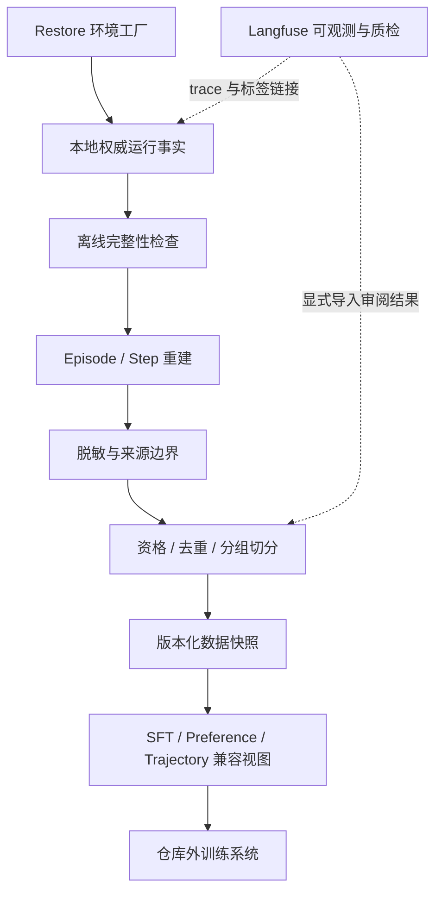
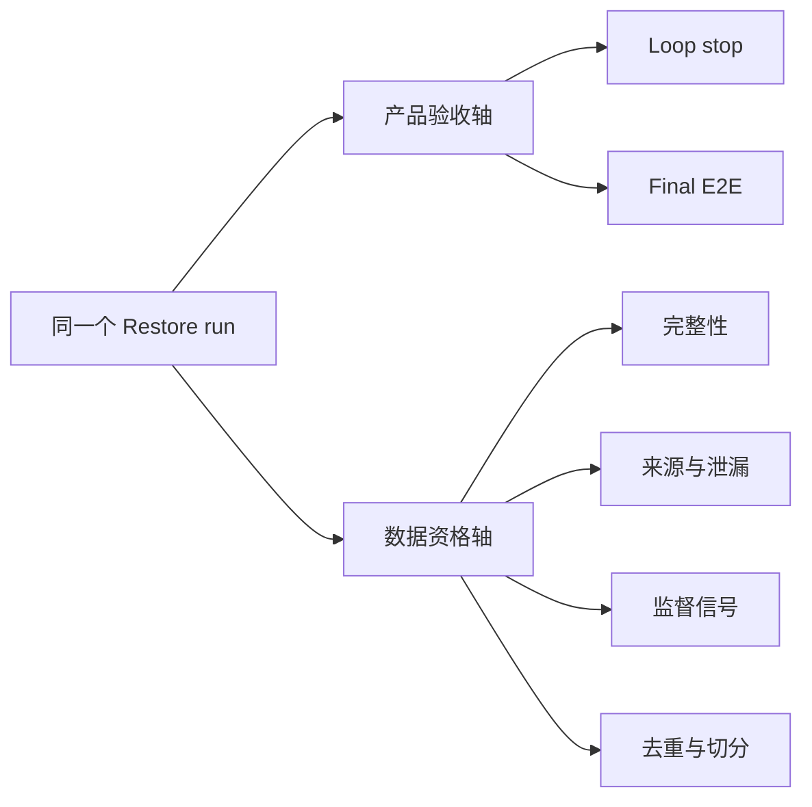
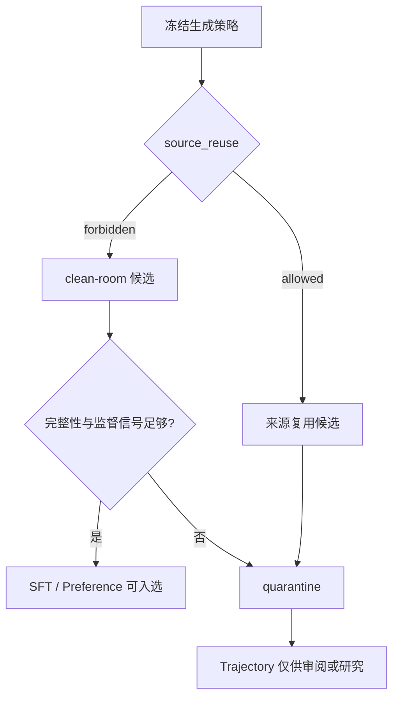

# Restore 数据工厂接口

本页是 Restore 运行数据后处理、训练候选资格和数据快照的唯一控制文件。Restore Loop/E2E 的停止、评分与验收仍由原控制文件负责；本页不修改它们。

## 边界

本项目提供“环境工厂 + 离线 Data Refinery”，不提供训练平台：



- `contract.json`、`run.json`、`events.jsonl`、`observations/`、`snapshots/` 是事实源。
- `report.json` 是审阅投影，不作为训练数据事实源。
- Langfuse 是可选控制面：关联 trace、评分和人工质检。它不是 run 身份或真值存储，网络写入也不替代本地回执。
- 本层不调用模型、不上传、不执行 SFT/DPO/RL、不管理 checkpoint/模型注册表。
- 仅导出公开 action、observation、state、decision 与 evidence 引用；不恢复或保存隐藏思维、私有推理、scratchpad。

## 两条独立判定轴



Final E2E `pass` 不自动得到训练资格；Final E2E `fail/incomplete` 也不自动使过程数据无用。资格按用途分别记录：

| 视图 | 默认资格 | 默认排除 |
| --- | --- | --- |
| SFT | 完整性有效；存在独立 assessment；至少一个 `keep` | `source_reuse=allowed`、无独立 assessment、无已接受迭代 |
| Preference | 完整性有效；存在独立、结论明确的 keep/revert pair | `source_reuse=allowed`、只有 inconclusive 或无独立 pair |
| Trajectory | baseline → iteration → stop 顺序完整 | 来源复用不直接删除，但标为需审阅并进入 quarantine |

这是保守默认值，不是新验收门槛。修改资格规则必须版本化 Schema/导出器和快照，不能回写历史 run。

## source-assisted 与训练候选

`source_assisted` 是生成过程策略；`source_reuse=allowed` 表示冻结合同允许把公开源代码、资源或运行时纳入生成输入。它有助于技术选型和设计目标理解，但训练数据可能学到源站实现或近似复制路径。因此：



本层不重新推断“是否真的复用”；它使用冻结合同的显式政策，避免根据相似度或文件名猜测。若政策记录错误，应建立新 run 或显式数据勘误，不静默改标签。

## 处理顺序

1. **完整性**：核对冻结合同摘要、参考证据字节哈希、快照树哈希、observation/diff/static-check 指针和事件 JSONL。
2. **重建**：将 baseline、每轮 repair/measure/verify/decision 和 stop 投影为 `AgentEpisode/v1` + `AgentStep/v1`。
3. **最小化**：只保留公共行为与证据引用；二进制和项目文件不默认复制。
4. **来源隔离**：按冻结 `generation_policy` 计算用途资格；`source_reuse=allowed` 默认隔离 SFT/Preference。
5. **资格**：对 SFT、Preference、Trajectory 分别判定，保留原因码。
6. **去重**：按 Episode 内容 fingerprint 精确去重；fingerprint 不含 run/step 身份、时间和 Langfuse 链接，避免同一内容因观测状态变化重复入库，但不用近似相似度静默合并。
7. **分组切分**：同 case 或 lineage root 只能进入同一 split，防止相邻 run 泄漏。
8. **快照**：生成不可覆盖的新目录、manifest、JSONL、quarantine 和中性导出视图。

Episode/Step 的概念可映射到 RLDS 一类的 Episode/Step 数据模型，但当前 Schema 是本仓库契约；没有宣称与 RLDS、某个训练框架或云数据集格式直接兼容。

## 运行包

```powershell
node scripts/data-factory/export-run.mjs <run-directory> <new-package-directory>
node scripts/data-factory/export-run.mjs <run-directory> <new-package-directory> --trajectory <trajectory-directory>
```

输出：

```text
package/
  manifest.json              RunDataManifest/v1
  episode.json               AgentEpisode/v1
  steps.jsonl                AgentStep/v1
  artifacts.index.jsonl      原 run 证据与产物引用，不复制大文件
```

如 run 目录存在 `generation-input.json`，导出器核对其 run/contract 绑定并标记 `model_input_proof=true`。不存在时仅从冻结合同重新投影 allowlist，标记 `model_input_proof=false`；这不能证明当时模型实际收到的完整请求。

`--trajectory` 只读取既有 `binding.json` 与 delivery manifest/result，核对 `run_id` 后记录 trace ID 和状态。凭据、远端完整 trace 与媒体不会复制进包。Langfuse 的人工标签若要影响资格，必须由后续显式、版本化的导入步骤完成；当前导出器不会用远端状态静默改写 run。

## 数据快照

```powershell
node scripts/data-factory/build-snapshot.mjs <new-snapshot-directory> <package>... --dataset-id <id>
```

输出：

```text
snapshot/
  manifest.json              DatasetSnapshot/v1
  episodes.jsonl
  steps.jsonl
  quarantine.jsonl
  splits/{train,validation,test}.jsonl
  exports/{sft,preference,trajectory}.jsonl
```

切分使用 `dataset_id + group` 的 SHA-256 模 100：train 0–79、validation 80–89、test 90–99。`group` 优先为 `case_id`，否则为 lineage root，再否则为 contract hash。它保证同组稳定且不跨 split，但不保证小样本比例精确。

SFT 视图把已验证 `keep` 的修复 action 作为目标，并把验证结果保留在 `quality`，不把评估文字误作 Agent action。Preference 视图保留 best/candidate 选择和独立 pairwise 证据；Trajectory 视图保留完整顺序。三者都是训练系统的中性输入，不是已清洗完成的训练集承诺。训练方仍需基于任务做内容安全、许可证、PII、分布、质量校准和目标格式转换；这些步骤不在本项目实现。

## Schema 与变更

- [RunDataManifest/v1](run-data-manifest.schema.json)
- [AgentEpisode/v1](agent-episode.schema.json)
- [AgentStep/v1](agent-step.schema.json)
- [DatasetSnapshot/v1](dataset-snapshot.schema.json)

Schema 变化、资格原因码变化或切分策略变化必须生成新快照；不得覆盖已有包或快照。真实 case 产物继续留在忽略目录，不提交到 Skill 仓库。
