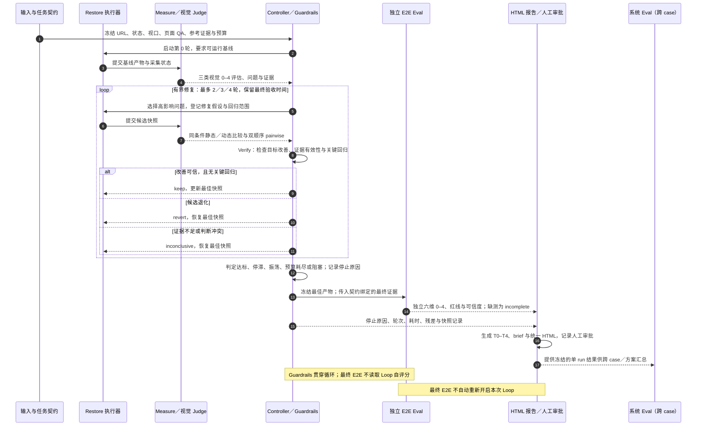

# Restore v0.2：视觉自检与独立验收执行规范

状态：运行控制器、证据契约和报告器已实现；Python Playwright 采集器在本地合成页面完成取证试跑。独立视觉与 E2E Judge 仍需要按 [接口](restore/interfaces.md)接入，未接入时输出 `incomplete`，不虚构分数。旧 v0.1 单 case 试点保留原报告口径。

## 决策与职责

恢复过程优先优化**可观察的视觉表现**。阶段为：冻结参考与页面专属 QA → 首版产物 → 测量 → 选择高影响问题 → 一轮定向修复 → 证据化比较 → 保留/回退 → 达标或有界退出 → 独立六维 E2E → 同页审阅与审批。详细 0–4 rubric 见 [Criteria](restore/criteria.md)；命令、字段和预算见 [Interfaces](restore/interfaces.md)。

### Pipeline 泳道图

每条泳道代表一个执行责任。`Measure` 产出的证据可供最终验收复用，但三类 Loop 分数和修复偏好不传给独立 E2E grader。

| 模块 | What | Before v0.1 | After v0.2 | Why |
| --- | --- | --- | --- | --- |
| Criteria | 单 case 修复目标 | 静态/动态等多个诊断量与系统 E2E 自评分并列 | 三类视觉结果、页面专属 QA、0–4 rubrics | 减少重复信号 |
| Measure | 证据生成 | 手工编排截图与像素差 | 可复用采集适配器、证据绑定、绝对 Judge 接口 | 降低重复取证成本 |
| Verify | 本轮是否有效 | 每轮完整复测提案 | 局部详查＋哨兵；全局变更扩大范围，结束时全量 E2E | 提高每轮效率 |
| Controller | 有界循环 | 轮数/时间未填写，单 case 人工编排 | 三档预算与轮次、快照、停滞和振荡退出 | 防止无效打转 |
| Guardrails | 防止投机 | 报告完整性/哈希检查 | 参考冻结、评分证据、独立性、恢复最佳快照 | 阻断“材料齐全即质量好” |
| 最终验收 | 是否交付 | 运行报告与六维实现者自评混排 | 单次最终六维 E2E 独立评分，未知保持待判 | 保持系统 Eval 边界 |

## 时间与范围

每页按复杂度和关键资源重建难度较高者分档：ordinary 30 分钟/2 轮，refined 60 分钟/3 轮，complex 120 分钟/4 轮。多页任务按页累计，共享已有取证。分档在前 5 分钟确定，冻结前可变更一次，但起始时间不重置。参考受验证、登录或资源缺失时记录观察限制；不把验证页当原目标。不可获取的素材应选择可观察视觉最接近的替代并标出残差。

时间上限按有效执行时间计算。额度限制、宿主故障或等待用户恢复造成的外部暂停，只有在宿主起止时间可核查、且区间内无运行事件时才扣除；正常模型工作与工具等待仍计时。原始墙钟时间、暂停区间和校正值同时保留。事后校正不删除原停止事件，也不自动重新启动已结束的 Loop。

报告另列模型 token 消耗。每条用量绑定来源、Agent、阶段和采集窗口；输入含缓存输入，输出含推理输出，总量只计算输入＋输出。没有宿主或 API 用量记录时显示未知；只有部分 Agent 可归属时显示“部分覆盖”，不将已观察值写成整个系统总成本。字段和导入命令见 [Token 用量接口](restore/interfaces.md)。

优先复用原站实际用于目标区域的图片、字体、图标与公开资源；根据可见效果选择实现框架。不按源码长度或技术栈同名程度评还原质量。普通信息页在 30 分钟内先有可运行基线，迭代针对最显著偏差；复杂 3D/动态保留必要时间轴和多帧证据。

## 最终结果

1. `Loop stop reason` 只解释停止原因；`target_reached` 不自动代表 E2E 通过。
2. `E2E result` 由独立 grader 使用现有六维 0–4 Rubric 和红线评最终冻结项目；它不读取修复者的自评分，也不自动恢复循环。六维权重及 ≥75 提案线仍按 [现有 E2E Spec](../evals/specs/site-restore-v1.md)，当前没有校准结果。
3. `Approval decision` 由审阅者在 HTML 中记录并导出本地 JSON；绑定最终报告和模板哈希。不认证身份或向服务器提交。
4. 对需要定位的失败红线，可在运行目录的 `evidence/visual-annotations.json` 提供 `VisualAnnotationSet/v1`：标注记录绑定红线 ID、原截图 URI 与 SHA-256、状态、视口、bbox 和标注图 URI 与 SHA-256。报告器验证两张图的哈希后，在最终质量区显示标注图和原截图链接；缺少 sidecar 时不改变既有报告。

独立 grader 不可用或预算不足时输出 `incomplete`，并交付可运行产物、证据和残差。跨 case 的系统评测消费这些 run 的冻结产物、时间和结果，不向当前 run 回传封存 case 标签或其他实验组得分。

## 实施边界与已知限制

- Node 控制器能限制脚本动作和子进程；宿主模型调用若不支持 deadline/cancel，时间限制只能协作式执行，报告注明 `enforcement`。
- browser capture 为可选 Playwright adapter；需要宿主已有相应依赖。LLM Judge adapter 为显式协议，本仓库不附未校准模型配置或假分数。
- 运行报告与动态检查取决于实际采集证据。多帧 JSON 可以证明采样时间和状态，但真正的视觉质量仍须独立评委评估。
- v0.2 运行时与单次报告入口位于 `scripts/restore/`；独立系统 E2E grader 位于 `evals/pipeline/grader.mjs`。旧 v0.1 报告作为静态历史产物保留，不再提供重渲染兼容层。
