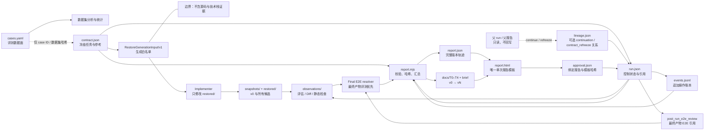

# Restore v0.2 接口与命令

适用于实现者和工具接入者；日常执行先看 [Restore 执行流程](../restore.md)。运行工具位于 `scripts/restore/`，最终 E2E grader 位于 `evals/pipeline/grader.mjs`。Node 20+，仅浏览器采集需要宿主提供 Playwright。CLI 不自行安装依赖、不猜测模型 API。

## 职责边界

| 模块 | 契约 | 决策 |
| --- | --- | --- |
| Criteria | `criteria.md` + 每页冻结 obligations | 什么算忠实 |
| Measure | `Capture/v0.2` + `LoopAssessment/v0.2` | 证据与绝对质量 |
| Verify | `IterationDecision/v0.2` | keep / revert / inconclusive |
| Controller | `run.json`、预算与追加式 `events.jsonl` | 下一步与停止原因 |
| Guardrails | 哈希、状态覆盖、证据引用、限时限轮 | 拒绝无效进步 |

## 数据所有权与报告流



| 产物 | 所有权 | 可否手改 | 职责 |
| --- | --- | --- | --- |
| `contract.json` | run 输入 | 冻结前可改；冻结后不可覆盖 | 目标、页面状态、视觉义务、参考证据 |
| `RestoreGenerationInput/v1` | Controller 投影 | 生成；不反写 | 传给实现者的唯一白名单输入；不含 case 源码和技术栈证据 |
| `run.json` | Controller | 仅命令更新 | 当前阶段、轮次、最佳快照、停止与审批引用 |
| `lineage.json` | `continue` / `refreeze` 命令 | 创建后不可覆盖 | 可选的父 run、父账本、父冻结契约和继承产物哈希；`contract_refreeze` 另绑定显式新合同来源及其参考证据集 |
| `events.jsonl` | Controller | 只追加 | 操作顺序与可追溯状态变化 |
| `observations/`、`snapshots/` | 评测/运行器 | 运行记录不可覆盖 | 原始评分、版本 Diff、静态检查、验证证据和全部候选快照；新记录的 assessment 证据归档在 `observations/evidence-archive/<sha256>/` |
| `design_brief.md` | Implementer / Report renderer | run 内工作副本可随实现更新；`report` 会重生成规范化终版 | 实现者所需的范围、状态、资源和残差工作文档；冻结要求仍以 contract 为准 |
| `report.json`、`docs/`、`report.html` | Report renderer | 生成产物，不应手改 | 面向审阅的汇编与导航；改事实源后重生成 |
| `approval.json` | Reviewer / `approve` 命令 | 独立记录 | 人工结论；必须匹配当前报告和模板哈希 |

E2E 的评测对象始终是最终交付产物。原始运行过程可能在 `run.json.e2e` 留下评测尝试；运行后对最终产物完成的独立评测保存为 `PostRunE2EReview/v1`，由 `run.json.post_run_e2e_review` 以 URI、SHA-256、状态和评测完成时间引用。该记录绑定同一 `run_id`、冻结契约哈希和最终产物哈希。若该记录存在，报告和审批使用它作为唯一最终 E2E 结果；原始 `run.json.e2e` 保留作运行审计，不作为并列质量模块，也不改写停止原因或预算归属。评测元数据记录 Judge provider/model、评测起止时间和时区、Rubric/Scorer 版本、校准状态、产物哈希及局限，不记录评委角色或标识。未暴露的模型名写 `null`，同时将 `judge_model_status` 设为 `not_exposed`；不从宿主型号推断判官型号。

如人工评审裁决某条红线，使用 `evidence/human-adjudications.json`（[`HumanAdjudicationSet/v1`](human-adjudication.schema.json)）追加记录。报告保留 `e2e_judge_result` 原始 Judge 结论，并将裁决后的状态作为本次报告的 `e2e` 最终口径；页面并列展示原始状态、裁决状态、原因、范围、时间和证据。可选 `dimension_notes` 只澄清对应维度的理由，不改变评分。该 sidecar 不改写哈希绑定的 `PostRunE2EReview/v1`。任何从 fail 改为 pass 的裁决，都必须满足其余红线通过且所有适用维度均达到 3/4；裁决不得调整分数。

报告在完整五维评分可用时显示完整加权总分。若存在未知维度，`report.json.e2e.total_100` 保持 `null`；报告另计算 `e2e_scoring_summary`，按已评分维度权重归一化显示暂分，并同时显示覆盖权重和未评分维度。该暂分不代替完整总分，也不改变 E2E 状态、红线或审批门禁。

### 证据不可变性与历史报告重放

`freeze`、`assessment-input`、`initial-record`、`record`、`static-check-record`、`eval-record` 等运行期路径继续对证据文件做 SHA-256 校验；缺失或哈希漂移必须 fail-closed，不能用当前同名文件替代历史内容。`initial-record` 与 `record` 在严格校验通过后，将 `LoopAssessment/v0.2.evidence[]` 归档至本 run 的 `observations/evidence-archive/<evidence_sha256>/content.<格式>`，并让持久化 assessment 引用归档 URI。同字节内容复用同一文件，证据 ID、时间、状态和其他事件元数据仍分别保留；格式根据内容识别，未知二进制为 `.bin`。归档已有目标时再次核对内容哈希；写入通过同目录临时文件及原子链接发布，文件系统不支持时明确失败。这样后续版本即使覆盖 `evidence/foo.png`，已记录版本仍引用不可变副本。历史 URI 不迁移，原样读取；新旧 URI 可共存。

临时诊断截图、录屏和请求放在对应 run 的 `scratch/` 或系统临时目录；进入合同或评估的证据按正式 URI 保存。收尾前核对引用，未知与未覆盖范围保留，不自动删除历史文件。运行 `node scripts/restore/archive-audit.mjs RUN` 可只读核验该 run 的归档哈希并列出相同内容的重复路径；其字节数是逻辑冗余量，不等于实际磁盘占用。引用扫描仅查本 run 指定文本文件中的字面 URI，发现引用记为 `observed`，其余记为 `unknown`，不覆盖其他 run、动态引用及过大或不可读文件，不能作为删除许可；归档缺失、不可读或不支持的条目使归档扫描标为 incomplete，引用扫描缺口另列。

收尾时运行 `node scripts/restore/scratch-audit.mjs RUN` 生成 `scratch/` 的只读清单；目录尚未创建时返回 `not_created`。工具只查本 run 指定文本文件中的字面路径；发现引用为 `observed`，未发现为 `unknown`。链接、不可读目录或超过 16 MiB 的文本等扫描缺口使 `complete: false`。无论结果如何都不推断可删除，也不移动或删除文件；其他 run、动态引用和系统临时目录不在扫描范围。

哈希口径分两类，不能混用。`run.json` 内指向结构化 JSON 记录的引用（包括 `static_checks[].sha256`）保存 `digest(value)`，即对键排序后的 canonical JSON 做 SHA-256；对应 `static-check-<digest>.json` 文件名也使用这个规范化摘要。因此它不要求等于 pretty-printed JSON 文件的逐字节 SHA-256。`evidence[].sha256` 始终校验 URI 指向文件的原始字节；当一份静态检查 JSON 又被评估记录作为 `kind: checks` 的证据引用时，必须重新读取该文件并计算字节 SHA-256，通常会与 `run.static_checks[].sha256` 不同。前者保护结构化事实的语义内容，后者保护证据文件的实际字节；两值不同不是漂移。v0.2 保留现有字段以兼容历史 run，未来如更名为 `canonical_digest` / `file_sha256` 需通过版本化 Schema 迁移。

仅 `report` 的只读历史重放允许在证据文件缺失、绑定 snapshot 缺失或证据/绑定哈希漂移时继续生成。此时 `report.json.integrity.status` 必须为 `degraded`，`integrity.issues[]` 逐项记录 `version_id / evidence_id / uri / expected_sha256 / actual_sha256 / error`；HTML 顶部必须显示同一清单。受影响证据标为 degraded，不渲染有效截图/视频缩略图；依赖它的 Loop unit、gate、finding、版本决策、静态检查、E2E 维度或红线不得作为质量结论，正向审批关闭。结构化事实源本身的哈希、冻结契约、lineage、assessment/decision 记录、最终产物或报告补充文件被改写时仍失败；该降级路径不是修复或接受篡改，只为让旧 run 可审计。

E2E 维度 ID 采用英文并与 `evals/pipeline/grader.mjs` 保持一致；文档用中文描述维度时按以下映射理解：

| 文档名称 | `dimensions[].id` | 权重 |
| --- | --- | ---: |
| 视觉结构与布局 | `layout` | 20 |
| 视觉样式与细节 | `style` | 20 |
| 内容与组件完整性 | `content` | 20 |
| 交互与状态 | `interaction` | 20 |
| 响应式与运行稳健性 | `robustness` | 20 |

[`FinalEvalRequest/v0.2`](final-eval-request.schema.json) 绑定 case、冻结契约、参考输入、状态、obligations 和最终产物。冻结契约使用 [`RedlineProfile/v1`](redline-profile.schema.json) 将六个共享红线绑定到本 case 的适用性、必测状态、关键区域、obligation、触发/不触发示例及证据要求。Rubric v1.2-draft 的新评测必须提供完整 profile；旧版冻结合同可以保持原样。E2E 结果的每条红线按 [`E2ERedlineAssessment/v1`](e2e-redline.schema.json) 保存适用性、状态、严重度、主要影响、受影响状态/区域及证据。grader 同时核对这些字段与冻结 profile 的范围，不会从视觉证据自动推断缺陷严重度。最终判定与评分锚点以 [Restore 最终 E2E](../../evals/restore.md) 为准。

当前 `report.json` 使用 `schema_version: RestoreReport/v0.2`，结构由 renderer 组装和基础断言约束；**仓库尚无独立的 v0.2 Report JSON Schema**。这不是第二套报告数据，而是一个可维护性缺口：后续若要让外部工具消费或做跨版本迁移，应先抽出正式 Schema 和兼容策略，再接入验证。

报告证据区按页面状态分行、按冻结参考/`v0` 初始版本/逐轮候选分列；最佳快照在其对应版本列标记，独立 E2E 证据并入该最佳版本。报告同时用 `trajectory[]` 展示每个版本的产物哈希、文件 Diff、义务分数变化、gate 状态变化、finding 增减、自动检查、验证和决策；revert 与 inconclusive 版本不得省略。截图依次依据显式 `state_id`、采集序列清单中的截图 URI/状态键、obligation 的证据引用对齐；采集状态键按与冻结状态 ID 的最长前缀匹配。采集状态优先于 obligation 引用，避免同一张输入截图因被多个评分义务引用而跨状态重复；缺少可确认关联时才放入“未关联状态”，不按数组顺序猜配。跨版本继承的相同 evidence ID 只在首次来源列显示，避免证据重复。检查 JSON、视频和其他非截图证据放在可展开的补充区。

## 最短运行链

```powershell
node scripts/restore/cli.mjs init reverse_output/example_20261014 https://example.com ordinary
# 编辑 run 内的 contract.json，保存参考证据到 evidence/；填写 observed_url、环境、状态、视觉 QA、启动命令、最终 E2E 版本。
node scripts/restore/cli.mjs freeze reverse_output/example_20261014
# 只把白名单输入交给实现者；cases.yaml 的源码/技术栈证据不进入该文件。
node scripts/restore/cli.mjs generation-input reverse_output/example_20261014 reverse_output/example_20261014/generation-input.json
# 在 restored/ 生成 v0 初始版本；由独立诊断器从 assessment-input 生成 LoopAssessment/v0.2。
node scripts/restore/cli.mjs assessment-input reverse_output/example_20261014 reverse_output/example_20261014/request.json
node scripts/restore/cli.mjs initial-record reverse_output/example_20261014 reverse_output/example_20261014/initial-assessment.json
# 每个版本可录入一个或多个规范化检查套件；summary 由控制器重算。
node scripts/restore/cli.mjs static-check-record reverse_output/example_20261014 reverse_output/example_20261014/static-check-suite.json
node scripts/restore/cli.mjs begin reverse_output/example_20261014 reverse_output/example_20261014/hypothesis.json
# 修改 restored/，采集受影响状态和哨兵；独立绝对评委生成 reverse_output/example_20261014/candidate-assessment.json。
node scripts/restore/cli.mjs verify reverse_output/example_20261014 reverse_output/example_20261014/candidate-assessment.json pairwise-adapter.mjs
# verify 返回带 A/B 双顺序证据的 assessment 与 verification 路径：
node scripts/restore/cli.mjs record reverse_output/example_20261014 <verify-assessment.json> <verify-verification.json>
node scripts/restore/cli.mjs next reverse_output/example_20261014
# 停止后由独立 Eval 模块评最终版，缺少 Judge adapter 则如实返回 incomplete。
node scripts/restore/cli.mjs eval reverse_output/example_20261014 evals/pipeline/grader.mjs judge-adapter.mjs
node scripts/restore/cli.mjs report reverse_output/example_20261014
```

已冻结 run 的预算或轮数用尽，但任务明确需要继续时，创建新的关联 run；不得修改父 run 的时间戳、契约、停止事件或账本：

```powershell
node scripts/restore/cli.mjs continue reverse_output/old_run reverse_output/new_run complex
node scripts/restore/cli.mjs assessment-input reverse_output/new_run reverse_output/new_run/continuation-v0-request.json
node scripts/restore/cli.mjs initial-record reverse_output/new_run reverse_output/new_run/continuation-v0-assessment.json
```

`continue OLD_RUN NEW_RUN [TIER]` 要求父 run 已冻结且存在 `best` 快照，并要求父子 run 位于可建立相对链接的同一文件系统。命令复制冻结的 `contract.json`、其 `reference_evidence` 文件和父 `restored/` 当前工作树，创建全新的 `run_id`、起始时间、预算和事件账本，并写入 [`RestoreLineage/v1`](lineage.schema.json)。若父工作树等于 `best`，`artifact_source` 为 `best_snapshot`；若父 run 在预算耗尽时仍有未验证候选，当前工作树按 `working_tree_unverified` 继承。两者都只作为新 run 待重新测量的 `v0`，不会继承父评分、keep 结论、轮次、E2E 或审批。生成策略原样继承，因此 `source_assisted` 不会被降级或扩权，`cases.yaml` 的评测侧源码证据仍不得进入生成输入。

延续 run 同时获得独立、可写的 `design_brief.md`：父 brief 存在时复制内容；不存在时从冻结 contract 投影最小工作 brief。`lineage.json.parent.design_brief` 保存确定性的父 brief 相对链接及可用时的创建时哈希，`lineage.json.inherited.design_brief` 保存子副本的来源与初始哈希；该哈希只证明创建来源，不锁定后续可写内容。新报告只显示本 run 的轨迹；lineage 总是预先记录确定性的父报告相对链接，即使父报告尚未生成，父报告在创建时已存在才同时记录内容 SHA-256。父 `run.json` 与 `events.jsonl` 的创建时字节哈希用于审计，父文件后续如有合法追加也不反写子 run。

冻结后发现关键路径、页面状态或验收义务遗漏时，不得使用 `continue`，也不得直接改写旧 run。先在独立 staging 目录准备完整 `contract.json` 及其引用证据，再创建合同重新冻结 run：

```powershell
node scripts/restore/cli.mjs refreeze reverse_output/old_run reverse_output/new_run staging/new-contract complex
# 审阅新 run 内的 contract.json；如需可继续在 prepare 阶段修正。
node scripts/restore/cli.mjs freeze reverse_output/new_run
node scripts/restore/cli.mjs assessment-input reverse_output/new_run reverse_output/new_run/refreeze-v0-request.json
node scripts/restore/cli.mjs initial-record reverse_output/new_run reverse_output/new_run/refreeze-v0-assessment.json
```

`CONTRACT_SOURCE` 可为含 `contract.json` 的目录，或直接指向 JSON 文件；`reference_evidence[].uri` 都相对该来源根目录解析。`refreeze` 要求父 run 已冻结且存在可校验 `best`，并要求显式新合同与父冻结合同不同。它只复制父 `best` 快照到新 `restored/` 和 `snapshots/`，不复制父工作树中未验证候选，不继承评分、轮次、E2E 或审批。新 run 以 `phase: prepare` 开始，必须再调用 `freeze` 锁定最终合同，再将继承产物作为全新 `v0` 重测。

`freeze` 还要求最终权威合同继续不同于父冻结合同，防止 `prepare` 阶段把遗漏义务回退掉。重新冻结的参考证据 URI 只能位于 `evidence/` 或 `reference-source/`。控制器在新 run 创建时及最终 `freeze` 时调用同一门禁，并按 Windows 大小写不敏感语义规范化路径；路径段尾随点/空格、NTFS 冒号数据流和 Windows 保留设备名同样拒绝。该白名单把 `.lock`、合同、账本、lineage、`restored/`、`snapshots/`、`discarded/`、`observations/`、`docs/`、报告和审批文件全部留给控制器管理。

`RestoreLineage/v1.relationship` 用 `continuation` 与 `contract_refreeze` 区分两种关系。后者记录父冻结合同、父 best、新合同来源的 canonical 哈希与字节哈希、其参考证据列表哈希、生成策略和继承产物。新合同来源另存为 `refreeze-contract-source.json`；报告会重放这些绑定。`contract.json` 在 `prepare` 中可继续修正，因此报告分别显示新合同来源哈希与本 run 最终冻结哈希；任何修正都不会伪装成父评分的延续。

对最终产物完成评测后，将结果按 [`PostRunE2EReview/v1`](post-run-e2e-review.schema.json) 写成 `review.json`，再运行 `node scripts/restore/cli.mjs post-run-review-record RUN review.json` 固化哈希引用和事件账本。报告将其作为唯一最终 E2E；原始运行评测尝试只留在 run 审计记录中。`interaction` 和 `robustness` 允许 evaluator 使用浏览器 browse control 点击控件、改变输入值、观察反馈及检查视口；必须记录实际动作与未覆盖项，不能把未检查的控制台或资源状态记为通过。复评应新增哈希版本并更新当前引用，保留旧审阅文件供审计，不覆盖原 JSON。

额度限制、宿主故障或等待用户恢复造成的**外部暂停**，在取得宿主时间证据后用 `time-exclude RUN interval.json` 登记。输入含 `schema_version:"TimeExclusion/v0.2"`、`start_at`、`end_at`、`reason:quota_limit|user_wait|external_block`、`source`。控制器拒绝与既有运行事件重叠的区间；预算只扣除已证实的外部暂停。模型思考、工具调用和正常取证仍计执行时间。运行已停止时保留原停止事件，报告追加校正结论，不暗改历史，也不自动重开 Loop。

模型用量由宿主或模型 API 提供后，执行 `usage-record RUN token-usage.json`。输入遵循 [TokenUsage/v0.2 Schema](token-usage.schema.json)：`coverage:partial|complete`、`coverage_note`、`records[]`。每条 record 含唯一 `id`、`stage:restore_loop|finalization|supplemental_audit|other`、`agent`、`source_type:codex_session|model_api|manual`、可追溯的 `source_ref`、起止 `window`、`response_count` 和 `usage`。`usage` 的 `input_tokens` 包含 `cached_input_tokens`，`output_tokens` 包含 `reasoning_output_tokens`，`total_tokens=input_tokens+output_tokens`。不把缓存或推理字段重复加到总量；不以账户剩余额度反推单 run 用量。缺少可归属记录时报告显示 `unavailable`，部分来源时必须写 `partial` 和缺口。`report.json.token_usage` 保存汇总与逐来源记录，HTML 展示总量及分段。旧报告无此字段时按未知处理。

Codex 宿主可用 `node scripts/restore/extract-codex-usage.mjs manifest.json token-usage.json` 从指定的会话 JSONL、root turn 与时间窗口抽取 `token_usage_record`。manifest 使用 `CodexUsageExtraction/v0.2`，含 `coverage`、`coverage_note`、`sources:[{id,file,stage,agent,source_ref,root_turn_ids,start_at,end_at}]`。输入日志路径仅用于本机抽取，输出只保留线程引用；脚本按响应 ID 去重并拒绝重复跨段计数。抽取结果仍需 `usage-record` 固化为带哈希的 run 观察记录；补记用量会改变报告哈希，旧审批失效。

`next` 返回 `repair`、`verify`、`abort`、`final_e2e` 或 `report`。没有可用的独立评委时，可用 `eval-record` 输入经独立评分器产生的结果；否则执行 `eval` 并标记 `incomplete`。提前阻塞使用 `stop RUN blocked "原因" blocker.json`；失败使用 `stop RUN failed "原因"`。`v0` 不计修复轮数；每次尝试含回退和待判都计一轮并进入版本轨迹。`baseline` 命令保留为 `initial-record` 的兼容别名，新流程不再把第一个版本作为报告主概念。`profile RUN TIER` 只可在 freeze 前调整一次；累积时间不重置。

`progress RUN` 是只读状态快照，不追加事件或改变阶段。输出 phase/stage、`version_count`、completed_rounds、pending_round、`round_limit`、budget、最佳产物哈希、静态检查套件数与最新汇总、units、gates、findings、last_decision、stop 和 final_e2e，供执行 Agent 编写用户可见进度；发送时机见执行 SOP。

`budget_basis` 为 live 或 loop_stop；停止后的 Loop 预算按 stop.at 计算，避免把交付后闲置时间当成运行耗时。仍在 final 阶段时另列实时 finalization_budget，反映最终评测的剩余总预算。

`RestoreBlocker/v1` 的字段由 [blocker.schema.json](blocker.schema.json) 定义：scope、reason、可核对 evidence、attempts 和 remaining_work。scope 只能是 reference_capture/assets/runtime/loop_measure/loop_verify；不能以 final_e2e Judge 缺失单独停止 Loop。attempts 的状态为 failed/unavailable；remaining_work 必须为 done/blocked/not_applicable，pending 工作会拒绝停止。控制器验证本地证据哈希和引用后保存 `observations/blocker-<hash>.json`，在 `run.stop.blocker` 记录引用，报告加载时复核。结构验证不能证明理由真实，因果判断仍由执行者负责。已有历史停止记录不回填、不重写。

## 证据与输入

- `contract.json`：记录 URL、浏览器环境、states、obligations、运行门禁、原站参考证据及其哈希。每个 state 有 `id/page_id/viewport_id/path/viewport/ready_selector/regions/steps/sentinel`，可选 `session_id`。每项 obligation 对应有效区域、状态与 C1/C2/C3；C3 `not_applicable` 必须说明参考确无对应动态。
- `contract.generation_policy`：冻结 `mode:fixture_only|source_assisted`、`case_metadata_visibility:id_only` 和 `source_reuse:forbidden|allowed`。可选 `case_source` 只允许 `case_id` 与 `dataset_sha256`。`technology_stack*`、`source_code_evidence`、`source_repository` 等评测字段进入合同会被拒绝。生成投影按 [`RestoreGenerationInput/v1`](generation-input.schema.json) 输出；顶层采用 allowlist，新增字段默认不能穿透。
- `contract.interactive_scene`：可选 [InteractiveScene/v1](interactive-scene.schema.json)，保存冻结的 transitions 和 rendering 观察，每项明确 observed/inferred/unknown 与证据引用。转换绑定有效 state_id；模型、相机、光照、材质、动画/命中等按实际需要记录。该字段原样进入 measure、pairwise verify、最终 E2E 请求及报告/brief，不另存一份可手改的玩法事实。实现后的残差归 assessment。
- 证据项：`{id,kind,uri,sha256}`，`uri` 为 run 内相对路径；支持 screenshot、sequence、video、checks、source。冻结后不得替换参考素材；改变任务契约需关联新 run 并保留原预算口径。
- `LoopAssessment/v0.2`：`binding` 必须等于 assessment request；`assessor:{role:'independent'|'implementer',id}`；`evidence`；`covered_states`；`units:[{obligation_id,status:'scored'|'unknown'|'not_applicable',score:0..4|null,reason,evidence:[id]}]`；`gates:[{id,status:'pass'|'fail'|'unknown',evidence:[id]}]`；`findings:[{id,obligation_id,severity:'blocking'|'obvious'|'minor',description,evidence:[id]}]`。基线另需 `stability:{status:'stable'|'variable',reason,evidence:[id]}`。
- `hypothesis.json`：`{issue_id,hypothesis,strategy,scope:'local'|'global',affected_states:[id],expected_change,preserve}`。每轮只处理一个偏差簇；复用同一失败假设触发停滞保护。
- `IterationDecision/v0.2`：`{schema_version,issue_id,binding,verifier:{role:'independent',id},evidence:[id],forward,reverse,visible_improvement,reason}`。前后两次比较均把结果归一为 `candidate / best / same / uncertain`；增量 keep/revert/inconclusive 的唯一判定规则见 [Loop Criteria](criteria.md#measure--verify)。
- [`StaticCheckSuite/v1`](static-check.schema.json)：绑定 `run_id / artifact_sha256 / contract_sha256`，记录 stage、executor、起止时间、证据和 checks。每项 check 含唯一 ID、`syntax|http|content|runtime|browser|resources|accessibility|security|performance|quality|custom` 类别、`pass|fail|unknown|skipped` 状态、严重度、expected、actual、evidence 和可选 duration。控制器忽略输入 summary 并从检查项自动重算 total/pass/fail/unknown/skipped、blocking failures、覆盖率与 `pass|fail|incomplete`；未执行不能写 pass。套件证据若引用 `restored/...`，报告按 `artifact_sha256` 从 `snapshots/<artifact_sha256>/...` 读取，并先校验整份 snapshot 哈希；普通 `evidence/...`、日志和截图仍按 run 相对路径读取。运行期缺失或篡改必须失败；只读历史报告重放按“证据不可变性与历史报告重放”降级，不能回退到当前工作树。静态检查是确定性门禁和诊断，不替代 C1–C3 或最终视觉 Judge。
- [`ArtifactDiff/v1`](artifact-diff.schema.json)：每个候选相对开始本轮时的最佳快照记录 added/modified/removed 文件、未变文件数、义务分数变化以及 finding 的 resolved/introduced 集合。它描述版本变化，不自行证明视觉改进。

适配器协议：本地 Node 脚本从 stdin 读一份 JSON，从 stdout 只输出一份 JSON；诊断日志写 stderr。`measure RUN adapter.mjs output.json` 传 `LoopAssessmentRequest/v0.2`；`verify RUN assessment.json adapter.mjs` 对同一问题做 A/B 与 B/A 两次独立调用，返回的 `PairwiseVerdict/v0.2` 含 `binding/issue_id/choice:'A'|'B'|'same'|'uncertain'/assessor:{role:'independent',id}/reason/visible_improvement`，并生成交给 `record` 的两个文件；`eval RUN evals/pipeline/grader.mjs judge.mjs` 传 `FinalEvalRequest/v0.2`。最终红线字段按 [`E2ERedlineAssessment/v1`](e2e-redline.schema.json) 表示，包含适用性、状态、S0–S3 严重度、影响类型、受影响状态/区域和证据；具体 criteria 与级别映射见 [Restore 最终 E2E](../../evals/restore.md#3-红线)。采集优先用已安装的 Python Playwright：`python scripts/restore/capture.py RUN reference|candidate BASE_URL output.json`；Node 环境已安装 Playwright 时也可用同目录 `capture.mjs`（若不在模块解析路径，设置 `RESTORE_PLAYWRIGHT_MODULE` 为其入口文件）。采集文件是证据，不能自动当作评分。原有 `compare-screens.py` 是局部诊断工具。

受限宿主若拒绝启动 Node 子进程，adapter 可改为导出 `async function evaluate(input,args)`，调用器自动转为同进程执行；此模式只能协作式限时，运行报告保留 `enforcement: cooperative`。适配器没有接通可用的视觉模型时必须返回未测或终止，不可生成占位分数。

参考采集后可将需要复用的已观察 URL、目标区域和视觉作用写入选择数组，调用 `node scripts/restore/collect-assets.mjs RUN reference-capture.json selection.json`。工具并发下载至内容哈希缓存并生成 `asset-map.json`，不可访问项保留原因。选择必须基于参考真实加载的资源；下载不会自动改写页面代码。

资源输入也可为宿主浏览器 `pageAssets.list()` 导出的原始 inventory（`pageUrl` 与带 `sources` 的 `assets`）；不把无状态码的宿主清单伪造成 HTTP 200。下载时再验证 HTTP 结果。每项选择含 `url/region/role`，可选 `max_bytes`，默认 20 MiB，最高 200 MiB；未明确选择的依赖不会自动爬取。GLB/glTF 取回后可运行 `node scripts/restore/inspect-gltf.mjs MODEL output.json [已观察来源URL]`，输出文件哈希、对象数量、动画轨道时间范围、压缩扩展和外部依赖 URI。此工具不获取依赖、不决定引擎归因，也不证明玩法已复现。

### 输入轨迹与动态采样

每个 state 可选 `ready_checks:[{selector,state}]`，state 为 visible/hidden/attached/detached；可选 `ready_timeout_ms` 为大于 0 且不超过 120000 ms，默认 30000 ms。它是该状态导航、主地标、附加就绪检查和字体等待共享的总就绪上限，并受 run 截止约束。3D 场景可在 canvas 可见之外要求加载遮罩 hidden；不能只据 canvas 存在认定模型加载完成。

默认每个 state 使用独立浏览器上下文，不共享 cookie 或 localStorage。只有冻结契约显式给多个 state 设置同一个 `session_id` 时，采集器才按 states 数组顺序在同一持久化上下文中为每段 trajectory 打开新页面；每段仍独立导航、取证和记录 `session_id`。共享会话禁止 `storage_state` 预载，并要求视口与配色一致，避免把注入存档或隐式环境漂移冒充真实进度。定向 candidate 采集若请求共享会话中的后段，计划必须自动包含从该会话首段到最晚请求段的有序前缀；不得从空存档直接运行后段。任一前置段或清理失败会使该会话失效，后续段只记录 `prerequisite` 失败，不新建空上下文继续执行。这只用于目标确有跨导航/跨载具的长程路径；能从 fresh profile 独立完成的状态继续保持默认隔离。

`state.steps[]` 遵循 [CaptureStep/v1](capture-step.schema.json)，由 `capture-actions.mjs` 做语义检查；Python 由共享 `capture-plan.mjs` 验证后执行同样输入。支持 click/hover/key/scroll/wait，以及 drag、key_hold、wheel、fill、select、reload。`reload` 在同一浏览器上下文中重新加载当前页面，以验证 localStorage 等跨导航持久化；它不新建上下文，也不清除存储，可配合 `ready_selector` 等待重载后的地标。selector 指向已观察目标；click.position 和 drag.path 的 x/y 是元素边界框内的 0–1 坐标。drag.path 包含 2–100 个点，at_ms 从 0 开始、非递减且不超过 5000 ms；capture:true 在对应点采帧。key_hold.duration_ms、wait.ms 同样限定 0–5000 ms，结束或失败后释放输入。

`capture_at_ms` 是 1–20 个严格递增采样偏移，范围 0–5000 ms。对 click/key/drag 等动作，偏移仍从输入动作完成后起算，默认 `[0]`。对 `key_hold`，偏移改从 keydown 起算、每个值必须不超过 `duration_ms`，采样时按键保持按下，到 `duration_ms` 才释放；未显式提供时默认在 `duration_ms` 采集一次最终持有状态。现有帧标签继续使用 `after-{offset}` 以保持证据 URI 兼容，语义以 action 类型为准。ready_selector 等待在输入结束后执行，不计入持有内采样偏移；超时不缩短成一次“成功”的 wait。Node/Python 采集器在导航前安装 Playwright page clock，每次截图先冻结 Chromium 页面生命周期，再在页面的同一个执行任务内原子读取当前虚拟时间并暂停 page clock；PNG 序列化结束后按相反顺序恢复。原子暂停不使用固定时间增量，避免公开 `pauseAt(先前读到的时间)` 在协议往返后落入过去，也不为每帧人工增加页面时间。因此截图自身的宿主耗时不推进 `requestAnimationFrame`、`Date`、`performance` 或页面定时器，也不挤占后续采样偏移。每帧的 `clock_isolation` 记录模式、冻结页面时间和排除的宿主毫秒数；action 同时记录 active `input_duration_ms`、`elapsed_ms`、`wall_elapsed_ms` 与 `excluded_capture_ms`。动作、ready 等非截图操作仍按正常页面时间执行；该隔离依赖支持 Clock API 与 Chromium CDP lifecycle 的 Playwright/Chromium，不是跨浏览器虚拟时间规范。普通截图仍受渲染管线和帧边界影响，不能保证命中某个亚帧瞬间，也不补造确定性。Capture 增加 actions 与 request_failures；失败状态保留包含 URL、错误和已完成帧的 diagnostic_uri，不能因遥测请求失败就推导主页面失败。

```json
[
  {"action":"drag","selector":"canvas","path":[{"x":0.45,"y":0.55,"at_ms":0},{"x":0.65,"y":0.55,"at_ms":300,"capture":true}]},
  {"action":"click","selector":"canvas","position":{"x":0.5,"y":0.5},"capture_at_ms":[0,120,350,800]}
]
```

这只是输入格式示例，真实落点、路径与时序必须来自参考观察。Node/Python 采集器通过共享 capture plan 使用同一冻结契约验证、artifact binding、pending 状态范围和含已证明外部暂停的截止时间。已停止 run 不自动重开预算。

失败状态的已完成资源响应仍可用于 `collect-assets`：工具先核对 diagnostic_uri 对应的证据哈希，再只接受其中实际记录为 2xx 的 URL。取得这些文件不改变该状态的失败结论。

### 区域可见性事实

`Capture/v0.2.states[].facts.regions[]` 的新增字段遵循 [`CaptureRegionFact/v1`](capture-region.schema.json)，是向后兼容的增量；原有 `selector/rect/style/text/missing` 字段保留。每项同时记录 `client_rect`（与历史 `rect` 同值）、与当前视口的 `intersection`、元素自身的 `display/visibility/opacity`、`aria_hidden`（属性缺失为 `null`）、`hidden` 属性、`visibility_reasons[]` 与归一化 `visible`。

`visible:true` 仅在以下条件同时成立时成立：元素存在；自身及祖先均没有 `hidden`、`aria-hidden=true`、`display:none`、`visibility:hidden|collapse` 或 `opacity<=0`；client rect 宽高为正；且与视口交集宽高为正。文本存在或非零 rect 不能单独证明可见。缺失 selector 也返回完整字段集，其中 `missing:true`、`visible:false`，其余不可取得的显示字段为 `null`。该判断不模拟像素级遮挡、`clip-path`、mask、混合模式或另一个高层元素的覆盖；这些情况仍须以截图及交互证据判断，不能仅凭 `visible:true` 宣称用户实际看见或可操作。

## 冻结与输出

- `run.json`：起始时间、档位、轮次、当前候选和最佳快照、停止记录、最终 E2E、token 用量及审批引用。
- `PostRunE2EReview/v1`：最终产物 E2E 评测记录；以哈希绑定到 `run.json` 引用。它是报告和审批读取的权威最终结果；原始运行 E2E 尝试仅保留在 `run.json.e2e` 审计字段。结构定义见 [`post-run-e2e-review.schema.json`](post-run-e2e-review.schema.json)。
- `snapshots/`：按项目内容哈希保存 `v0` 与所有候选；回退将工作目录移入 `discarded/`，保留失败实验。
- `observations/`：评估、`ArtifactDiff/v1`、`StaticCheckSuite/v1` 及验证原始 JSON；`events.jsonl`：追加式操作账本。运行文件在 `.gitignore` 中忽略，避免提交参考素材和用户项目。
- `report` 从以上事实源自动生成 T0–T4、`design_brief.md`、`report.json`、`report.html`。T2 是完整版本轨迹，T3 是逐轮生成/评估/Diff/修复决策，T4 汇总最终验收与自动检查。`report.json.e2e` 是规范化后的唯一最终 E2E 结果：优先读取 `run.json.post_run_e2e_review` 指向的最终产物评测，否则读取 `run.json.e2e`。证据重放异常按“证据不可变性与历史报告重放”降级，不得形成正向审批。审批导出 JSON 后运行 `approve RUN approval.json`；批准只依据这一份最终 E2E 的状态、红线和分数，未校准须人工复核。有条件批准必须记录条件。
- `report.json` 是本次 run 的结构化审阅快照，不是第二份事实源：它汇总 `run.json`、冻结的 `contract.json`、Loop 评估/验证、独立 E2E、证据索引和用量记录，并带入报告需要展示的字段。`report.html` 是单一呈现层，引用同一 run 内的证据、T0–T4 和账本；HTML 不另存评分或过程数据。`approval.json` 单独记录人工决定，并绑定规范化报告 JSON 与 `assets/restore/report.html` 的 SHA-256；数据或模板变化后，旧审批失效。
- 当前报告模板唯一来源为 `assets/restore/report.html`，渲染器为 `scripts/restore/report.mjs`。v0.1 的 HTML、Schema、演示输入和命令包装器已退役；本地已有的 v0.1 `report.html` 保持可读，但旧 run 不会被伪装成 v0.2 或重新渲染。跨 case 版本评测报告仍使用 `evals/templates/report.md`，与单次 run 报告职责不同。
- 同一案例的多次关联 run 可用 `node scripts/restore/challenge-report.mjs OUTPUT_DIR RUN_DIR...` 生成 [`RestoreChallengeReport/v2`](challenge-report.schema.json) 确定性投影及单文件 HTML。投影从每个 run 的 `run.json`、`contract.json`、`events.jsonl`、`lineage.json`、observation、可用的 `report.json`、assessment、verification、diff 与 static suite 建立 provenance DAG；节点只保存身份、状态、哈希和来源引用，大证据不复制进聚合文件。边明确区分 continuation、contract refreeze、contains、input、produced、assessed、verified、diffed、diagnosed 与 final-evaluated；无父 run、循环或不合法 legacy linkage 进入 `provenance.issues`，不得静默修复。缺失输出必须使用结构化 `reason_code`、`cause_layer`、`recoverability`、`source_ref` 和 `affected_conclusions`，不能只写 `unknown`。聚合器不写回评分或账本；横向 comparison group 的键固定为 `contract_sha256 + rubric_version + scorer_version`，跨组分数只能展示，不能解释为同口径改进。Final E2E、Loop 状态覆盖和绑定 `run.best` 的 StaticCheckSuite 分栏显示，不合成第二套总分。

## 预算与停止

| 档 | 总上限 | 修复轮数 | 最终检查预留 |
| --- | ---: | ---: | ---: |
| ordinary | 30 分钟 | 3 | 3 分钟 |
| refined | 60 分钟 | 6 | 6 分钟 |
| complex | 120 分钟 | 9 | 12 分钟 |

取证最多六分之一；`v0` 初始版本目标在总时间一半前。控制器在下一动作前检查剩余**有效执行时间**；报告同时保留墙钟跨度、已证实外部暂停和有效耗时。超时或达到轮次上限时交付最佳已有版本，但报告仍保留全部候选。`target_reached / plateau / cycle_detected / budget_exhausted / blocked / failed` 是 Loop 停止原因；`pass / fail / incomplete` 是 E2E 结果；审批状态单独记录。调用中强制停止依赖宿主的 deadline/cancel 支持，单纯 Skill 编排是协作式限时。
