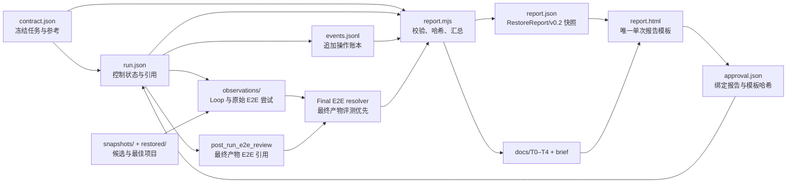

# Restore v0.2 接口与命令

适用于实现者和工具接入者；日常执行先看 [Restore 执行流程](../restore.md)。运行工具位于 `scripts/restore/`，最终 E2E grader 位于 `evals/pipeline/grader.mjs`。Node 20+，仅浏览器采集需要宿主提供 Playwright。CLI 不自行安装依赖、不猜测模型 API。

## 职责边界

| 模块 | 契约 | 决策 |
| --- | --- | --- |
| Criteria | `criteria.md` + 每页冻结 obligations | 什么算忠实 |
| Measure | `Capture/v0.2` + `LoopAssessment/v0.2` | 证据与绝对质量 |
| Verify | `IterationDecision/v0.2` | keep / revert / inconclusive |
| Controller | `run.json`、预算与追加式 `events.jsonl` | 下一步与停止原因 |
| Guardrails | 哈希、状态覆盖、证据引用、限时限轮 | 拒绝无效进步 |

## 数据所有权与报告流



| 产物 | 所有权 | 可否手改 | 职责 |
| --- | --- | --- | --- |
| `contract.json` | run 输入 | 冻结前可改；冻结后不可覆盖 | 目标、页面状态、视觉义务、参考证据 |
| `run.json` | Controller | 仅命令更新 | 当前阶段、轮次、最佳快照、停止与审批引用 |
| `events.jsonl` | Controller | 只追加 | 操作顺序与可追溯状态变化 |
| `observations/`、`snapshots/` | 评测/运行器 | 运行记录不可覆盖 | 原始评分、验证证据和候选快照 |
| `report.json`、`docs/`、`design_brief.md`、`report.html` | Report renderer | 生成产物，不应手改 | 面向审阅的汇编与导航；改事实源后重生成 |
| `approval.json` | Reviewer / `approve` 命令 | 独立记录 | 人工结论；必须匹配当前报告和模板哈希 |

E2E 的评测对象始终是最终交付产物。原始运行过程可能在 `run.json.e2e` 留下评测尝试；运行后对最终产物完成的独立评测保存为 `PostRunE2EReview/v1`，由 `run.json.post_run_e2e_review` 以 URI、SHA-256、状态和评测完成时间引用。该记录绑定同一 `run_id`、冻结契约哈希和最终产物哈希。若该记录存在，报告和审批使用它作为唯一最终 E2E 结果；原始 `run.json.e2e` 保留作运行审计，不作为并列质量模块，也不改写停止原因或预算归属。评测元数据记录 Judge provider/model、评测起止时间和时区、Rubric/Scorer 版本、校准状态、产物哈希及局限，不记录评委角色或标识。未暴露的模型名写 `null`，同时将 `judge_model_status` 设为 `not_exposed`；不从宿主型号推断判官型号。

如人工评审裁决某条红线，使用 `evidence/human-adjudications.json`（[`HumanAdjudicationSet/v1`](human-adjudication.schema.json)）追加记录。报告保留 `e2e_judge_result` 原始 Judge 结论，并将裁决后的状态作为本次报告的 `e2e` 最终口径；页面并列展示原始状态、裁决状态、原因、范围、时间和证据。可选 `dimension_notes` 只澄清对应维度的理由，不改变评分。该 sidecar 不改写哈希绑定的 `PostRunE2EReview/v1`。任何从 fail 改为 pass 的裁决，都必须满足其余红线通过且所有适用维度均达到 3/4；裁决不得调整分数。

报告在完整五维评分可用时显示完整加权总分。若存在未知维度，`report.json.e2e.total_100` 保持 `null`；报告另计算 `e2e_scoring_summary`，按已评分维度权重归一化显示暂分，并同时显示覆盖权重和未评分维度。该暂分不代替完整总分，也不改变 E2E 状态、红线或审批门禁。

E2E 维度 ID 采用英文并与 `evals/pipeline/grader.mjs` 保持一致；文档用中文描述维度时按以下映射理解：

| 文档名称 | `dimensions[].id` | 权重 |
| --- | --- | ---: |
| 视觉结构与布局 | `layout` | 20 |
| 视觉样式与细节 | `style` | 20 |
| 内容与组件完整性 | `content` | 20 |
| 交互与状态 | `interaction` | 20 |
| 响应式与运行稳健性 | `robustness` | 20 |

[`FinalEvalRequest/v0.2`](final-eval-request.schema.json) 绑定 case、冻结契约、参考输入、状态、obligations 和最终产物。冻结契约使用 [`RedlineProfile/v1`](redline-profile.schema.json) 将六个共享红线绑定到本 case 的适用性、必测状态、关键区域、obligation、触发/不触发示例及证据要求。Rubric v1.2-draft 的新评测必须提供完整 profile；旧版冻结合同可以保持原样。E2E 结果的每条红线按 [`E2ERedlineAssessment/v1`](e2e-redline.schema.json) 保存适用性、状态、严重度、主要影响、受影响状态/区域及证据。grader 同时核对这些字段与冻结 profile 的范围，不会从视觉证据自动推断缺陷严重度。最终判定与评分锚点以 [Restore 最终 E2E](../../evals/restore.md) 为准。

当前 `report.json` 使用 `schema_version: RestoreReport/v0.2`，结构由 renderer 组装和基础断言约束；**仓库尚无独立的 v0.2 Report JSON Schema**。这不是第二套报告数据，而是一个可维护性缺口：后续若要让外部工具消费或做跨版本迁移，应先抽出正式 Schema 和兼容策略，再接入验证。

报告证据区按页面状态分行、按冻结参考/基线/逐轮候选分列；最佳快照在其对应版本列标记，独立 E2E 证据并入该最佳版本。截图依次依据显式 `state_id`、采集序列清单中的截图 URI/状态键、obligation 的证据引用对齐；采集状态键按与冻结状态 ID 的最长前缀匹配。采集状态优先于 obligation 引用，避免同一张输入截图因被多个评分义务引用而跨状态重复；缺少可确认关联时才放入“未关联状态”，不按数组顺序猜配。跨版本继承的相同 evidence ID 只在首次来源列显示，避免基线证据重复落入最佳版本列。检查 JSON、视频和其他非截图证据放在可展开的补充区。

## 最短运行链

```powershell
node scripts/restore/cli.mjs init reverse_output/example_20261014 https://example.com ordinary
# 编辑 run 内的 contract.json，保存参考证据到 evidence/；填写 observed_url、环境、状态、视觉 QA、启动命令、最终 E2E 版本。
node scripts/restore/cli.mjs freeze reverse_output/example_20261014
# 在 restored/ 生成可运行基线；由独立诊断器从 assessment-input 生成 LoopAssessment/v0.2。
node scripts/restore/cli.mjs assessment-input reverse_output/example_20261014 request.json
node scripts/restore/cli.mjs baseline reverse_output/example_20261014 baseline-assessment.json
node scripts/restore/cli.mjs begin reverse_output/example_20261014 hypothesis.json
# 修改 restored/，采集受影响状态和哨兵；独立绝对评委生成 candidate-assessment.json。
node scripts/restore/cli.mjs verify reverse_output/example_20261014 candidate-assessment.json pairwise-adapter.mjs
# verify 返回带 A/B 双顺序证据的 assessment 与 verification 路径：
node scripts/restore/cli.mjs record reverse_output/example_20261014 <verify-assessment.json> <verify-verification.json>
node scripts/restore/cli.mjs next reverse_output/example_20261014
# 停止后由独立 Eval 模块评最终版，缺少 Judge adapter 则如实返回 incomplete。
node scripts/restore/cli.mjs eval reverse_output/example_20261014 evals/pipeline/grader.mjs judge-adapter.mjs
node scripts/restore/cli.mjs report reverse_output/example_20261014
```

对最终产物完成评测后，将结果按 [`PostRunE2EReview/v1`](post-run-e2e-review.schema.json) 写成 `review.json`，再运行 `node scripts/restore/cli.mjs post-run-review-record RUN review.json` 固化哈希引用和事件账本。报告将其作为唯一最终 E2E；原始运行评测尝试只留在 run 审计记录中。`interaction` 和 `robustness` 允许 evaluator 使用浏览器 browse control 点击控件、改变输入值、观察反馈及检查视口；必须记录实际动作与未覆盖项，不能把未检查的控制台或资源状态记为通过。复评应新增哈希版本并更新当前引用，保留旧审阅文件供审计，不覆盖原 JSON。

额度限制、宿主故障或等待用户恢复造成的**外部暂停**，在取得宿主时间证据后用 `time-exclude RUN interval.json` 登记。输入含 `schema_version:"TimeExclusion/v0.2"`、`start_at`、`end_at`、`reason:quota_limit|user_wait|external_block`、`source`。控制器拒绝与既有运行事件重叠的区间；预算只扣除已证实的外部暂停。模型思考、工具调用和正常取证仍计执行时间。运行已停止时保留原停止事件，报告追加校正结论，不暗改历史，也不自动重开 Loop。

模型用量由宿主或模型 API 提供后，执行 `usage-record RUN token-usage.json`。输入遵循 [TokenUsage/v0.2 Schema](token-usage.schema.json)：`coverage:partial|complete`、`coverage_note`、`records[]`。每条 record 含唯一 `id`、`stage:restore_loop|finalization|supplemental_audit|other`、`agent`、`source_type:codex_session|model_api|manual`、可追溯的 `source_ref`、起止 `window`、`response_count` 和 `usage`。`usage` 的 `input_tokens` 包含 `cached_input_tokens`，`output_tokens` 包含 `reasoning_output_tokens`，`total_tokens=input_tokens+output_tokens`。不把缓存或推理字段重复加到总量；不以账户剩余额度反推单 run 用量。缺少可归属记录时报告显示 `unavailable`，部分来源时必须写 `partial` 和缺口。`report.json.token_usage` 保存汇总与逐来源记录，HTML 展示总量及分段。旧报告无此字段时按未知处理。

Codex 宿主可用 `node scripts/restore/extract-codex-usage.mjs manifest.json token-usage.json` 从指定的会话 JSONL、root turn 与时间窗口抽取 `token_usage_record`。manifest 使用 `CodexUsageExtraction/v0.2`，含 `coverage`、`coverage_note`、`sources:[{id,file,stage,agent,source_ref,root_turn_ids,start_at,end_at}]`。输入日志路径仅用于本机抽取，输出只保留线程引用；脚本按响应 ID 去重并拒绝重复跨段计数。抽取结果仍需 `usage-record` 固化为带哈希的 run 观察记录；补记用量会改变报告哈希，旧审批失效。

`next` 返回 `repair`、`verify`、`abort`、`final_e2e` 或 `report`。没有可用的独立评委时，可用 `eval-record` 输入经独立评分器产生的结果；否则执行 `eval` 并标记 `incomplete`。支持显式 `stop RUN blocked|failed 原因`。第 0 轮不计修复轮数；每次尝试含回退和待判都计一轮。`profile RUN TIER` 只可在 freeze 前调整一次；累积时间不重置。

## 证据与输入

- `contract.json`：记录 URL、浏览器环境、states、obligations、运行门禁、原站参考证据及其哈希。每个 state 有 `id/page_id/viewport_id/path/viewport/ready_selector/regions/steps/sentinel`。每项 obligation 对应有效区域、状态与 C1/C2/C3；C3 `not_applicable` 必须说明参考确无对应动态。
- 证据项：`{id,kind,uri,sha256}`，`uri` 为 run 内相对路径；支持 screenshot、sequence、video、checks、source。冻结后不得替换参考素材；改变任务契约需关联新 run 并保留原预算口径。
- `LoopAssessment/v0.2`：`binding` 必须等于 assessment request；`assessor:{role:'independent'|'implementer',id}`；`evidence`；`covered_states`；`units:[{obligation_id,status:'scored'|'unknown'|'not_applicable',score:0..4|null,reason,evidence:[id]}]`；`gates:[{id,status:'pass'|'fail'|'unknown',evidence:[id]}]`；`findings:[{id,obligation_id,severity:'blocking'|'obvious'|'minor',description,evidence:[id]}]`。基线另需 `stability:{status:'stable'|'variable',reason,evidence:[id]}`。
- `hypothesis.json`：`{issue_id,hypothesis,strategy,scope:'local'|'global',affected_states:[id],expected_change,preserve}`。每轮只处理一个偏差簇；复用同一失败假设触发停滞保护。
- `IterationDecision/v0.2`：`{schema_version,issue_id,binding,verifier:{role:'independent',id},evidence:[id],forward,reverse,visible_improvement,reason}`。前后两次比较均把结果归一为 `candidate / best / same / uncertain`；`forward=reverse=candidate` 且无关键回归才可 keep。

适配器协议：本地 Node 脚本从 stdin 读一份 JSON，从 stdout 只输出一份 JSON；诊断日志写 stderr。`measure RUN adapter.mjs output.json` 传 `LoopAssessmentRequest/v0.2`；`verify RUN assessment.json adapter.mjs` 对同一问题做 A/B 与 B/A 两次独立调用，返回的 `PairwiseVerdict/v0.2` 含 `binding/issue_id/choice:'A'|'B'|'same'|'uncertain'/assessor:{role:'independent',id}/reason/visible_improvement`，并生成交给 `record` 的两个文件；`eval RUN evals/pipeline/grader.mjs judge.mjs` 传 `FinalEvalRequest/v0.2`。最终红线字段按 [`E2ERedlineAssessment/v1`](e2e-redline.schema.json) 表示，包含适用性、状态、S0–S3 严重度、影响类型、受影响状态/区域和证据；具体 criteria 与级别映射见 [Restore 最终 E2E](../../evals/restore.md#3-红线)。采集优先用已安装的 Python Playwright：`python scripts/restore/capture.py RUN reference|candidate BASE_URL output.json`；Node 环境已安装 Playwright 时也可用同目录 `capture.mjs`（若不在模块解析路径，设置 `RESTORE_PLAYWRIGHT_MODULE` 为其入口文件）。采集文件是证据，不能自动当作评分。原有 `compare-screens.py` 是局部诊断工具。

受限宿主若拒绝启动 Node 子进程，adapter 可改为导出 `async function evaluate(input,args)`，调用器自动转为同进程执行；此模式只能协作式限时，运行报告保留 `enforcement: cooperative`。适配器没有接通可用的视觉模型时必须返回未测或终止，不可生成占位分数。

参考采集后可将需要复用的已观察 URL、目标区域和视觉作用写入选择数组，调用 `node scripts/restore/collect-assets.mjs RUN reference-capture.json selection.json`。工具并发下载至内容哈希缓存并生成 `asset-map.json`，不可访问项保留原因。选择必须基于参考真实加载的资源；下载不会自动改写页面代码。

## 冻结与输出

- `run.json`：起始时间、档位、轮次、当前候选和最佳快照、停止记录、最终 E2E、token 用量及审批引用。
- `PostRunE2EReview/v1`：最终产物 E2E 评测记录；以哈希绑定到 `run.json` 引用。它是报告和审批读取的权威最终结果；原始运行 E2E 尝试仅保留在 `run.json.e2e` 审计字段。结构定义见 [`post-run-e2e-review.schema.json`](post-run-e2e-review.schema.json)。
- `snapshots/`：按项目内容哈希保存候选；回退将工作目录移入 `discarded/`，保留失败实验。
- `observations/`：评估及验证原始 JSON；`events.jsonl`：追加式操作账本。运行文件在 `.gitignore` 中忽略，避免提交参考素材和用户项目。
- `report` 从以上事实源自动生成 T0–T4、`design_brief.md`、`report.json`、`report.html`。`report.json.e2e` 是规范化后的唯一最终 E2E 结果：优先读取 `run.json.post_run_e2e_review` 指向的最终产物评测，否则读取 `run.json.e2e`。审批导出 JSON 后运行 `approve RUN approval.json`；批准只依据这一份最终 E2E 的状态、红线和分数，未校准须人工复核。有条件批准必须记录条件。
- `report.json` 是本次 run 的结构化审阅快照，不是第二份事实源：它汇总 `run.json`、冻结的 `contract.json`、Loop 评估/验证、独立 E2E、证据索引和用量记录，并带入报告需要展示的字段。`report.html` 是单一呈现层，引用同一 run 内的证据、T0–T4 和账本；HTML 不另存评分或过程数据。`approval.json` 单独记录人工决定，并绑定规范化报告 JSON 与 `assets/restore/report.html` 的 SHA-256；数据或模板变化后，旧审批失效。
- 当前报告模板唯一来源为 `assets/restore/report.html`，渲染器为 `scripts/restore/report.mjs`。v0.1 的 HTML、Schema、演示输入和命令包装器已退役；本地已有的 v0.1 `report.html` 保持可读，但旧 run 不会被伪装成 v0.2 或重新渲染。跨 case 版本评测报告仍使用 `evals/templates/report.md`，与单次 run 报告职责不同。

## 预算与停止

| 档 | 总上限 | 修复轮数 | 最终检查预留 |
| --- | ---: | ---: | ---: |
| ordinary | 30 分钟 | 2 | 3 分钟 |
| refined | 60 分钟 | 3 | 6 分钟 |
| complex | 120 分钟 | 4 | 12 分钟 |

取证最多六分之一；首轮基线目标在总时间一半前。控制器在下一动作前检查剩余**有效执行时间**；报告同时保留墙钟跨度、已证实外部暂停和有效耗时。超时或达到轮次上限时交付最佳已有版本。`target_reached / plateau / cycle_detected / budget_exhausted / blocked / failed` 是 Loop 停止原因；`pass / fail / incomplete` 是 E2E 结果；审批状态单独记录。调用中强制停止依赖宿主的 deadline/cancel 支持，单纯 Skill 编排是协作式限时。
