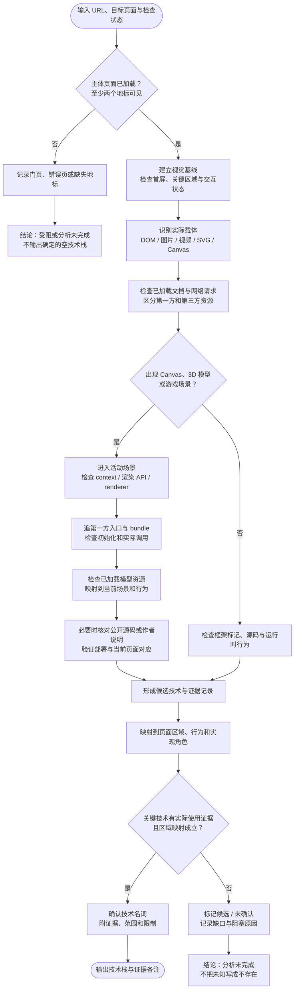

# 网站技术栈分析 SOP

本 SOP 用于从网页 URL 分析还原任务涉及的技术栈。目标是把页面实际可见、可交互的实现与可核查的技术证据对应起来；页面主题、品牌、资源供应商或视觉效果只能形成待核实线索。

## 工作原则

- **源码与视觉并行**：源码/运行时用于判断“页面由什么实现”；视觉检查用于判断“这些实现支撑了页面的哪些区域和行为”。任一方向单独使用，都可能漏项或误归因。
- **分析范围先固定**：记录目标 URL、最终落地 URL、页面/状态、视口、检查时间。平台资料页、嵌入作品和被介绍的产品要分别界定。
- **证据绑定结论**：每个技术名词都应能指向具体页面资源、代码、运行时行为或可重复观察的线索；页面名称和主题不算实现证据。
- **区分角色**：标记技术是页面核心渲染/交互依赖、页面框架、内容平台，还是平台级字体、视频、反机器人或分析服务。只纳入与目标页面还原有关的项。
- **未知不等于不存在**：没有找到证据时，记录“未确认/待查”，说明检查到哪一步；不能把没有检查写成“该页面没有使用”。

## SOP

### 1. 固定页面身份与加载状态

1. 打开目标 URL，记录最终 URL、页面标题和加载结果。
2. 以至少两个页面主体地标确认目标页已加载，例如标题、主要导航、核心内容区域或作品列表。若被登录、验证码、错误页或区域限制替换，记录可见状态及缺失的主体地标。
3. 只有当主体内容被门页替代或关键内容无法访问时，才判定本次被拦截。验证码脚本、reCAPTCHA 资源或第三方验证组件“已加载”本身不足以证明用户正停留在验证页。
4. 若目标为平台上的机构/作品资料页，明确被还原的是平台页面还是外链官网；不可把两者的技术栈混为一项。

### 2. 建立视觉基线

1. 保存目标视口的首屏截图；长页至少检查首屏、代表性中段和页尾。
2. 记录布局分区、主要内容、媒体区域、滚动表现及明显动效；执行关键导航、Tab、菜单或模式切换，观察状态变化。
3. 对大型动态区域特别确认其实际载体：普通 DOM 图片/视频、SVG、Canvas 2D、WebGL/WebGPU Canvas，或尚不能判断。不要从“看起来像 3D/粒子/动画”直接推断引擎或渲染 API。
4. 把视觉观察写成可复核事实，例如“主展示区存在一个 Canvas，滚动时内容持续变化”；将“该 Canvas 使用 Three.js”留给源码/运行时证据确认。

### 3. 主动发现源码并检查运行时

普通网站 URL 本身就是源码发现入口。不要等用户补交代码仓库链接。按以下路线检查页面公开、实际加载的资源；可按当前浏览器/连接器支持情况选择等价能力：

1. **从已加载文档找入口**：查看页面 HTML/DOM 中的 `script`、`link`、`modulepreload`、样式表、字体与媒体引用；检查页面暴露的构建/框架元数据。记录资源 URL、来源域名、资源类型和页面状态。
2. **从实际网络加载找依赖**：若浏览工具提供 Network/Performance 记录，读取当前页面真实请求及 initiator；否则读取页面可访问的 resource entries 或等价浏览器状态。优先分开第一方 bundle 与 CDN、分析、验证码、播放器等第三方资源。
3. **顺着第一方入口深入**：打开可公开读取的 JS/CSS bundle，查找 import/模块边界、框架 hydration 标记、渲染入口、Canvas/媒体初始化、样式变量和响应式规则。资源文件名和路径仅用于产生候选，不作为使用证明。
4. **检查公开源码映射**：若 bundle 明确引用 source map，且映射文件可公开读取，则用它追到源模块；如 HTML/构建资源提供公开 manifest，也可据其确认入口和 chunk 关系。只跟随页面公开暴露或明确引用的资源，不猜隐藏路径、不绕过访问控制，也不尝试取得非公开源码。
5. **压缩 bundle 定点检索**：先区分依赖代码与页面作者代码，再查候选技术的初始化/实例创建/调用点。bundle 中出现某库字符串，可能只是被打包、未使用或平台共享依赖；需与页面运行时对象或可见区域行为交叉验证。
6. **运行时核验**：检查 DOM 框架标记、实际挂载节点、Canvas 类型/上下文、资源 initiator、运行时日志和关键交互行为。框架指纹、文件路径、控制台单条日志分别都可能误报，使用相互独立的证据确认。
7. **与视觉并行闭环**：对页面的关键视觉区域/状态逐一确认对应 DOM、资源或渲染表面；若发现技术资源却找不到目标页面中的作用，先归类为平台/第三方/待确认，不直接列为核心实现。

#### 强制证据路线：Canvas、WebGL 与 3D 场景

遇到 Canvas、3D 视觉、模型文件（如 `.glb`/`.gltf`）或游戏交互时，不能在“发现 Canvas”处结束。按下面顺序完成检查，并逐项留证：

1. **确认活动内容**：触发开始按钮或进入场景，检查 Canvas、DOM 覆盖层、模型/纹理/音频资源和主要交互；不要只看落地首屏。
2. **识别渲染 API**：检查 Canvas 上下文或已加载源码中的 renderer 创建调用。仅 `<canvas>` 只证明载体；WebGL context 只证明 WebGL；`THREE.WebGLRenderer`、`new BABYLON.Engine` 等调用才支持具体引擎归因。工具拿不到上下文时，必须继续下一步。
3. **检查第一方入口与 bundle**：从 HTML 的 script/modulepreload、实际请求和 initiator 找到第一方入口；查 import、renderer 构造、Canvas 初始化及对应页面模块。遇到压缩 bundle，定点搜引擎名、renderer 类和初始化符号，并回看调用上下文。只看到包名不能单独证明它运行在目标区域。
4. **追踪模型资源**：记录首屏后实际请求的模型及其发起脚本/组件；模型资源与活动 Canvas/场景相对应时，作为 3D 场景的运行时交叉证据。单独出现模型文件可能是预载、下载或非当前页面内容，不能独立确定引擎。
5. **查公开的一手实现资料**：当浏览器限制阻止读 bundle 时，检查页面公开链接到的仓库、部署配置、源映射或作者对同一作品的明确技术说明。核对仓库和部署 URL/页面名称是否对应，并用当前页面资源或交互把仓库实现映射到线上页面。无映射时只记为旁证，不能代替当前页面证据。
6. **记录尚未确认的层级**：如果只确认 Canvas，而 API、引擎和来源源码都不可读，就保留 `HTML Canvas`，并写明已检查入口、bundle、资源、公开源码中的哪些项及阻塞原因；状态标为“分析未完成”。如果发现已加载 GLB、3D 场景和交互却仍只列 Canvas，必须说明为何引擎无法进一步确认，以及是否尝试过公开源码/作者说明。

提交前使用最小核对行：`活动状态 → Canvas/DOM → API → 引擎/renderer 调用 → 3D 资源 → 页面映射 → 来源与限制`。有可用证据却跳过任一环节，不算完成技术栈分析。

源码发现能力会因跨域策略、浏览器工具、登录状态、资源压缩和站点配置而变化。不可访问时，记录已走到哪一步、缺少何种证据以及阻塞原因，继续完成可做的视觉分析；不可把工具限制描述成网站没有源码，也不可把空栈描述为已确认不存在相关技术。

本流程提供可选的本地脚本辅助：[`scripts/stack-audit/`](../scripts/stack-audit/README.md) 用 Playwright 采集状态、请求、Canvas、截图和已加载的同主机源码；源码扫描只生成候选，人工裁决后由验证器检查证据映射和未解决信号。脚本是取证与质量门禁，不替代本 SOP 的页面归因判断，也不修改 `cases.yaml`。

### 4. 将实现证据映射到视觉区域

对每个候选技术填一条内部核验记录：

| 字段 | 记录内容 |
| --- | --- |
| 候选名词 | 技术名词，不带版本/功能描述 |
| 证据来源 | 源码、资源路径、DOM、运行时日志、可重复行为或截图 |
| 对象/位置 | 哪个脚本、元素、Canvas、组件、页面区域或交互状态 |
| 视觉/行为映射 | 该实现支撑的页面区域或行为；无法映射时说明其可能是平台/第三方依赖 |
| 判断 | 已确认、较强线索、未确认或排除；注明证据缺口 |

技术栈字段只输出已确认或达到项目证据门槛的**技术名词列表**。具体证据、范围、角色和不确定性写入证据备注，不塞进名词本身。单一弱线索（例如域名、文件名、通用 CSS 类名或控制台噪音）只能生成候选，不能直接升级成确定标签。

### 5. 三方交叉核验并收尾

逐项问：

1. **源码/资源是否存在？** 证据确实属于当前目标页及当前状态吗？
2. **页面是否实际使用？** 被加载的库可能是闲置代码、平台公共包或未使用组件；能否找到初始化、DOM/Canvas 实例、调用或对应行为？
3. **是否对应可见区域？** 该技术对要还原的目标区域是否有贡献？如果是分析服务、验证码支持库或隐藏管理模块，不应误当作核心 UI 技术。
4. **视觉与实现是否冲突？** 比如发现 Canvas 但无法识别 2D/WebGL，保留 Canvas 并将更具体类型标为未知；有 WebGL 也不自动等于 Three.js。
5. **关键检查是否做完？** 主页面已确认、关键媒体/画布/动效有实现检查、候选依赖已映射或明确未确认、拦截判断已核实。未达到这些条件时，状态为“分析未完成”，而不是给出确定的空栈结论。

## Three.js 等页面主题造成的归因陷阱

网站介绍 Three.js，只能证明它是页面内容主题，不能证明首页自身使用 Three.js。判断页面自身是否使用 Three.js，需检查页面实际加载的依赖/源码和对应渲染实例或行为；主页出现 `r186` 等版本字样属于内容证据，不是实现证据。

同理：

- 页面有 `<canvas>` 只能支持 Canvas；进一步区分 2D/WebGL/WebGPU 需要对应上下文或运行时证据。
- 有 WebGL 只能支持 WebGL 渲染；要标 Three.js 需 Three.js 资源、模块导入、运行时对象/调用等更具体证据。
- 页面加载 Google reCAPTCHA 不能单独证明当前用户被验证码拦截；必须检查主体内容是否被挑战页替代。
- 技术栈标签应服务于当前还原对象。平台公共字体或媒体播放器可作为该平台页面实现的一部分，但须与核心框架/渲染栈区分，并确认目标区域确实使用。

### 验证页误判复盘：UIR-0004

此前的浏览记录已看到 Build in Amsterdam 标题、Amsterdam 地点和资料页内容/作品计数等主体地标，同时也看到 reCAPTCHA 资源。主体内容已经呈现，因此当次访问不能判为停留在验证码页；reCAPTCHA 只能记为加载的公共资源。具体组件是否用于当前可见区域仍需另行映射，不能单靠资源存在推断。

复核门页时优先看页面正文是否被门页替换，再看最终 URL、标题和主体地标。保存门页截图/文本证据；如果主体内容仍在，记录“页面已到达，验证服务资源已加载”，不要写成“被验证码拦截”。

## Three.js 官网归因复盘：UIR-0006

### 2026-10-15 复核前的可验证状态

- 记录确认当时观察到了 Three.js 官网导航、项目展示墙和 `three.js r186` 字样。
- 案例记录明确说明没有检查页面自身使用的脚本、渲染上下文或展示墙实现。因此 `technology_stack: []` 代表证据核查没有完成，不能解释为确认该页不使用 Three.js。
- 仅凭页面主题把 `Three.js` 填入实现栈也不成立；需要页面自身的实现证据。

### 根因判断

**流程缺口（高置信）**：视觉观察结束后没有接续源码/运行时核验，也没有未完成标记或强制收尾问题，导致“没有证据”和“证据证明不存在”混在一起。

**停止原因（中置信，基于现有记录推断）**：为避免从站点主题误推实现，采取了过度保守的空列表；但没有执行下一步可用的证据检查。现有资料不足以还原完整推理过程，不能把该推断说成确定的模型内部原因。

**另一个风险**：案例把展示墙称作“静态缩略图”，但缺少 Canvas/媒体/运行时检查记录。这一描述同样可能超出已观察证据；后续应写“缩略图展示墙，载体未核实”，直到确认是图片、Canvas 还是实时 3D。

### 改进动作

1. 对有技术主题的产品官网，分别记录“页面介绍的技术”和“页面自身使用的技术”。
2. 看到动态展示墙后检查 DOM 媒体元素、Canvas 数量与上下文、脚本资源和运行时调用；确认其是图片网格、Canvas/WebGL 还是 Three.js 场景。
3. 若访问或工具限制阻止核验，保留标签空列表并写明待查项/阻塞原因；状态标为分析未完成，不能用“静态”或“不使用”收尾。
4. 按上面的收尾问题逐项完成后再更新技术栈；变更仅基于新证据，不因希望填满字段而补猜。

### 2026-10-15 运行时复核结果

- 当前首页的项目展示墙由外链 `<a>` 和 `/files/projects/*.jpg` 懒加载 `` 组成，没有 Canvas。
- 页面自身的可见交互脚本只用原生 JavaScript 切换侧栏的 `open` 类；没有加载 Three.js 模块。
- `r186`、TSL guide、仓库目录，以及 README 中的 WebGL/WebGPU renderer、ES Modules 示例和 SVG/CSS3D addons，均属于 Three.js 产品版本、能力或仓库结构证据，不是首页实现证据。
- 因此 UIR-0006 的当前页面实现栈记录为 `Vanilla JavaScript` 与 `HTML Image`。这不否认 Three.js 的产品能力，只是把还原对象和页面主题分开。

## 页面改版与历史证据复盘：UIR-0003

28K 的 2023 年版本有开发者公开陈述支持 Vanilla WebGL、JavaScript 和 shader；但 2026-10-15 的当前页面已经改版。规范域名首页与 `/work` 加载 Nuxt 模块，暴露 Nuxt payload/config 与 Storyblok 数据，使用 HTML Video，并预加载 PP Neue Montreal 字体；两页均未发现 Canvas。

这类证据不能合并成一个不带时间范围的技术栈。处理规则是：

1. 当前 URL case 的 `technology_stack` 只记录当前页面可复核的实现。
2. 历史版本证据留在 `technology_stack_evidence`，标明年份、来源与适用版本。
3. 字体、路由、预加载器和产品能力保留为视觉、结构或内容证据，不伪装成技术名词。
4. 若旧版视觉仍是评测目标，必须另存授权且冻结的历史 fixture；不能用已经改版的 live URL 代替。

## 防止复发的检查清单

- [ ] 目标 URL、最终 URL、页面状态和目标对象已确认。
- [ ] 主体页面不是挑战页/错误页；第三方验证脚本未被误判为拦截。
- [ ] 已保存视觉基线，并检查关键页面区域和交互状态。
- [ ] 动态媒体/Canvas 已识别到证据允许的具体层级；未把视觉效果直接推成框架。
- [ ] 对 3D/Canvas 页面已完成强制证据路线；如果最终只有 Canvas，已记录源码/API/模型检查情况和无法继续的具体原因。
- [ ] 每项技术都有页面自身的源码或运行时证据；证据已映射到区域/行为及其角色。
- [ ] 页面主题、第三方公共依赖、闲置资源没有被当作核心实现。
- [ ] 未检查项、工具限制和推断均明确标注；空列表不会掩盖“尚未分析”。

只要一项关键项未完成，记录应保持“分析未完成/待核实”；不影响已证实名词入库，但不得声称已完成技术栈分析。
